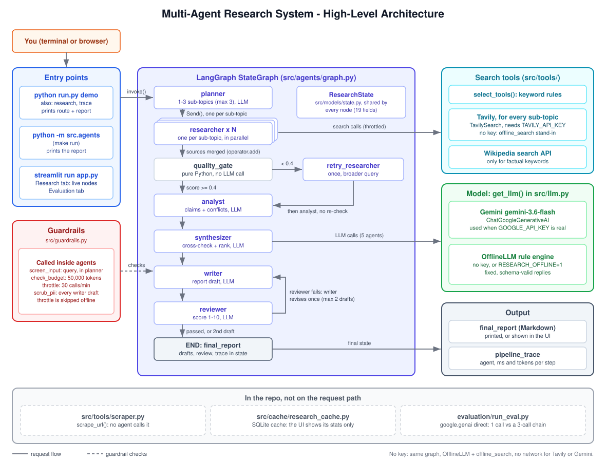

# Multi-Agent Research System

[](LICENSE)
[](https://www.python.org/)
[](#run-it)

A LangGraph pipeline that turns one research question into a cited report. A planner
splits the question into up to three sub-topics, one researcher per sub-topic searches in
parallel, a pure-Python quality gate scores the sources, and an analyst, synthesizer,
writer and reviewer turn them into a report. **The graph can go backwards**: a weak set of
sources gets one broader search, and a draft the reviewer rejects goes back to the writer.

It runs against Google Gemini and Tavily search when you have keys, and against a
deterministic offline stand-in for both when you do not. Python, LangGraph, Streamlit.

> Build it step by step on [AI-ML Companion](https://aimlcompanion.ai/module/aiAgents/agentsCapstone):
> guided walkthroughs, architecture decisions and hands-on challenges.



---

## Run it

No API key needed. Without one, the agents run in **offline mode**: a rule engine answers
the prompts the agents send, in the shapes they parse, and a stand-in returns sources in
place of web search. It is not a model, and the run says so on its first line.

You need [Python 3.12+](https://www.python.org/downloads/) and
[git](https://git-scm.com/downloads). Check with `python --version`.

```bash
git clone https://github.com/genieincodebottle/aiml-companion.git
cd aiml-companion/projects/agentic-ai/ai-agents-project

python -m venv .venv
source .venv/bin/activate        # Windows: .venv\Scripts\activate
pip install -r requirements.txt

python run.py demo
```

`run.py` needs no `make` and no install of the project itself. Its commands:

| Command | What it does |
|---|---|
| `python run.py demo` | Research one fixed topic through all eight nodes, print the route, then the report |
| `python run.py research <topic>` | The same, on your topic; prints the report only |
| `python run.py trace` | The route and the numbers, no report |
| `python run.py test` | The test suite (`pytest tests/ -q`) |
| `python run.py ui` | The Streamlit app (`streamlit run app.py`) |
| `python run.py evaluate` | Single call against a 3-call chain; needs `GOOGLE_API_KEY` |

Add `-v` to any of them to see the agents' own logs.

If you have `make` (Linux, macOS): `make test`, `make run` (`python -m src.agents`),
`make ui`, `make evaluate`, `make all` (tests, then a run, then the evaluation).

### Your first research run

1. Run `python run.py demo`. The first line says **OFFLINE run** when no key is set.
2. Read the route. On an offline run it is:

   ```
   planner -> researcher -> researcher -> researcher -> quality_gate -> analyst
     -> synthesizer -> writer -> reviewer -> writer -> reviewer
   ```

   `researcher` appears three times: one per sub-topic, in parallel. `writer` and
   `reviewer` appear twice: the reviewer scored the first draft 5 out of 10 and the graph
   went back to the writer.
3. Read the numbers under the route: 3 sub-topics, 15 sources, 5 claims, 1 cross-source
   conflict, 2 drafts, reviewer score 8. The offline sources disagree on purpose (falling
   unit costs, rising total spend), so the analyst always has a conflict to report.
4. Try `python run.py research "open-source LLM inference servers"` or open the app
   with `python run.py ui`: type a topic, click **Run Research**, and each node's output
   appears as it finishes, then the trace table and the report.

### Use real Gemini and Tavily (optional)

Get a Gemini key at <https://aistudio.google.com/apikey> and a Tavily key at
<https://app.tavily.com/home>, then:

```bash
cp .env.example .env      # Windows PowerShell: copy .env.example .env
# open .env and replace the two placeholder values:
#   GOOGLE_API_KEY=...
#   TAVILY_API_KEY=...
```

Run the same commands. Each half switches on its own: a real `GOOGLE_API_KEY` turns on
Gemini (`gemini-3.6-flash`, set in `configs/base.yaml`), a real `TAVILY_API_KEY` turns
on web search. The placeholders in `.env.example` count as missing. `run.py` loads `.env`
before it prints its offline banner, so the banner matches what runs. With only the Gemini
key set, the model is real but search returns offline placeholder sources: the writer is
told they are fabricated, and the report starts with a note saying so. Set both keys for
real research.

`RESEARCH_OFFLINE=1` forces offline mode even with keys; `RESEARCH_OFFLINE=0` forces the
real model.

`run.py` prints its OFFLINE line from the shell environment only, before `.env` is read.
If your key is only in `.env`, the line still says OFFLINE but the graph loads `.env` and
calls Gemini. Export the key in the shell to make the two agree.

---

## How one research run works

The whole graph is wired in [`src/agents/graph.py`](src/agents/graph.py) (`build_graph()`).

1. **Entry.** `run.py`, `python -m src.agents` ([`src/agents/__main__.py`](src/agents/__main__.py))
   and the Streamlit app ([`app.py`](app.py)) build the graph and invoke it with
   `{"query": ...}`. The app uses `app.stream()` to show each node as it finishes.
2. **planner** ([`planner.py`](src/agents/planner.py)). `screen_input()` checks the query
   against the prompt-injection patterns in [`src/guardrails.py`](src/guardrails.py). With
   `action: block` (the default) a match ends the run: no sub-topics, no report, the reason
   in `errors`. Otherwise one structured LLM call (`PlannerOutput`) returns 1 to 3
   sub-topics (`pipeline.max_sub_topics: 3`). If that call fails, the whole query becomes
   the only sub-topic.
3. **researcher x N** ([`researcher.py`](src/agents/researcher.py)). `route_to_researchers()`
   sends one `Send("researcher", ...)` per sub-topic, so they run in parallel.
   `select_tools()` ([`tool_selector.py`](src/tools/tool_selector.py)) uses keyword rules:
   Tavily always, plus Wikipedia when the sub-topic has a factual keyword such as
   "what is" or "history of". `throttle()` runs before each search; offline mode makes no
   network call, so the Wikipedia tool returns nothing there. Results are de-duplicated by
   URL, then `check_all_guardrails()` scans every snippet for prompt injection
   (`guardrails.prompt_injection`: `block` drops the source, `warn` logs it), and the rest
   are merged into `sources` by an `operator.add` reducer. No LLM call, 0 tokens.
4. **quality_gate** ([`quality_gate.py`](src/agents/quality_gate.py)). Pure Python: each
   source scores `0.6 x domain trust + 0.4 x snippet quality`, and the gate averages the
   top five. At 0.4 or above (`pipeline.quality_threshold`) the run goes to the analyst.
   Below it, `retry_researcher` searches once more with
   `"<query> comprehensive overview analysis"` and then goes to the analyst without a
   second gate.
5. **analyst** ([`analyst.py`](src/agents/analyst.py)). One structured call
   (`AnalystOutput`) over the first 10 sources: claims, each with a source index,
   confidence and evidence, plus cross-source conflicts.
6. **synthesizer** ([`synthesizer.py`](src/agents/synthesizer.py)). One free-text call
   that cross-references the claims and conflicts.
7. **writer** ([`writer.py`](src/agents/writer.py)). One call that drafts the report from
   the claims and synthesis, or revises the last draft against the reviewer's issues.
   `guardrails.pii_detection.action` decides what happens to emails, phone numbers and
   SSNs in each draft: `redact` (default) replaces them, `warn` logs them, `block` drops
   the draft.
8. **reviewer** ([`reviewer.py`](src/agents/reviewer.py)). One structured call
   (`ReviewOutput`): a score from 1 to 10, issues, suggestions and a `passed` flag. The code
   decides the pass itself: `score >= pipeline.review_pass_score` (7), whatever the model's
   flag says. Passed sets `final_report` (cut at `max_report_chars`) and ends the run. Not passed sends the draft back to the writer.
   The second draft is accepted whatever its score: `pipeline.max_revisions: 2` allows two
   drafts in total, one revision.
9. **Output.** The final state holds `final_report`, every draft, the review, the claims
   and `pipeline_trace` (agent, milliseconds and tokens per step). The entry point prints
   or renders it. `run.py demo`, `run.py research` and `python -m src.agents` exit with
   code 1 when there is no report.

That is 5 LLM calls on a run with no revision and 7 with one. Every agent that calls the
model gets it from `get_llm()` in [`src/llm.py`](src/llm.py), which returns Gemini or the
offline stand-in. Before each LLM call, `check_budget()` stops an agent once the run has
counted `budget.token_budget` tokens (50,000), and `throttle()` holds calls to 30 per minute (a sliding 60-second
window, `guardrails.rate_limit.max_rpm`; skipped offline). Tokens come from each response's
`usage_metadata` ([`src/token_usage.py`](src/token_usage.py)), not from estimates.

### LangGraph patterns in this code

| Pattern | Where | What it shows |
|---|---|---|
| `Send()` fan-out | planner to researchers | Parallel nodes from one list |
| `operator.add` reducer | `sources`, `token_count`, `errors`, `pipeline_trace` | Merging writes from parallel nodes |
| Conditional edge in plain Python | after `quality_gate` | Routing with no LLM call |
| Bounded loop | writer and reviewer | A cycle with a hard stop |
| `with_structured_output(..., include_raw=True)` | planner, analyst, reviewer | Pydantic output plus the real token count |
| YAML config | [`configs/base.yaml`](configs/base.yaml) | Thresholds, model, guardrail switches |

---

## The one rule

> **A run that did nothing must not look like a success.**

Every agent catches its own exceptions and returns a degraded state, so the graph always
reaches the end. The code is built so that a broken run still shows up as broken:

- **No report, non-zero exit.** `python -m src.agents`, `run.py demo` and `run.py research`
  exit with code 1 when `final_report` is empty; `python -m src.agents` also prints the
  first errors.
- **Offline replies fail loudly.** The stand-in builds real Pydantic objects and raises
  `OfflineFixtureError` on a prompt or schema it does not know, instead of returning
  something that parses.
- **Tokens are measured or zero.** A response without `usage_metadata` counts as 0 tokens
  and logs that the budget is blind for that call. A plausible guess would hide it.
- **Placeholder keys are not keys.** `has_real_key()` rejects the `.env.example` values,
  so a copied but unedited `.env` runs offline instead of failing inside the client.
- **Truncation is an error in the evaluation.** A response that hits its token cap
  raises instead of being scored as an incomplete report.

---

## Tests and evaluation

### Tests

233 tests, no API key, no network. Run `python run.py test` or `pytest tests/ -v`.

| File | Tests | Checks |
|---|---|---|
| `test_wiring_gaps.py` | 25 | Config keys are read, snippet screening and code-enforced review pass, offline makes no network call, run.py banner |
| `test_guardrail_enforcement.py` | 38 | SSRF and allowlist checks block, injection phrasings are caught |
| `test_e2e_pipeline.py` | 37 | Full graph with a mocked LLM: order, retry route, review loop, fan-out, budget, PII |
| `test_offline_mode.py` | 37 | Offline stand-in, placeholder keys, no silent success |
| `test_ui_smoke.py` | 26 | Streamlit app modules import and wire up (no server) |
| `test_guardrails.py` | 14 | PII, budget, rate limiter |
| `test_token_accounting.py` | 12 | Real usage is counted, not constants |
| `test_guardrails_wired.py` | 11 | Rate limiter and injection check run on the real request path |
| `test_graph.py` | 9 | Graph compiles; quality and review routing |
| `test_quality_gate.py` | 8 | Source scoring |
| `test_state.py` | 6 | State schema and Pydantic models |
| `test_cache.py` | 5 | SQLite cache read and write |
| `test_tools.py` | 5 | Tool selection rules |

### Single call against a 3-call chain

`python -m evaluation.run_eval` (or `make evaluate`, or the app's **Evaluation** tab)
answers test questions two ways and has Gemini judge each report on accuracy,
completeness and citations (0 to 3). It needs `GOOGLE_API_KEY`.

Read the arms carefully. Both call `google.genai` directly from
[`evaluation/run_eval.py`](evaluation/run_eval.py). The single-agent arm is one prompt.
The **multi-agent arm is a 3-call prompt chain** (research, analyse, write). It is **not**
the eight-node graph above: no planner, no fan-out, no quality gate, no reviewer.

Last recorded run: 2026-09-02, `gemini-3.6-flash`, the first 5 of the 10 questions, one
judge pass per report, paired by question.

| Metric | Single call | 3-call chain | Paired delta (SE) | Reads as |
|---|---|---|---|---|
| Accuracy (0-3) | 3.00 (SD 0.00) | 2.60 (SD 0.55) | -0.40 +/- 0.24 | within noise |
| Completeness (0-3) | 1.00 (SD 0.00) | 1.40 (SD 0.89) | +0.40 +/- 0.40 | within noise |
| Citations (0-3) | 1.60 (SD 0.89) | 2.20 (SD 0.84) | +0.60 +/- 0.40 | within noise |
| Tokens per report | 2,561 | 13,447 | 5.3x | measured |
| Latency | 19.2 s | 67.9 s | 3.5x | measured |
| LLM calls | 1 | 3 | 3x | by design |

At n=5 this run cannot tell the two apart on quality: every quality delta is smaller than
twice its standard error. The chain used 5.3 times the tokens and 3.5 times the wall
clock. To claim a difference you need more questions, repeated judge passes, or both.

The table in `artifacts/results/evaluation_results.md` (+18% accuracy) is from an earlier
version of the harness and is not reliable: per-call caps of 1000 to 2000 tokens cut
reports off mid-sentence, because `gemini-3.6-flash` spends about 940 tokens reasoning
before it writes, and its cost column could not have come from this code. Truncation now
raises, and token counts are reported instead of money (set `PRICE_PER_1M_INPUT` and
`PRICE_PER_1M_OUTPUT` in `run_eval.py` if you want a conversion).

---

## What this is, and what it is not

A **reference implementation for learning** LangGraph orchestration: parallel fan-out,
reducers, conditional routing, a bounded loop, structured output and per-call token
accounting. It is not a production research service. Gaps found in the code:

- **The scraper is never called.** `src/tools/scraper.py` (`scrape_url`) and its SSRF
  guard (`validate_url`) work and are tested, but no agent uses them. Sources are search
  snippets only. When it is called, it reads `url_validation.allowed_domains` and
  `timeout_seconds` from the config.
- **The SQLite cache is not on the request path.** `src/cache/research_cache.py` stores
  and reads sources, but no agent calls it; the Streamlit sidebar only shows its stats.
- **Offline token counts are estimates** (about four characters per token) so the budget
  has something to measure.
- **The budget is checked between calls.** An agent under the cap can still make one
  call that goes over it.
- **`warn_at_percent`, `graceful_degradation`, `model.fallback` and `pii_detection.patterns`
  are not read.** The warning level in the app is a fixed 80 percent.
- **The evaluation script** reports a currency column only if you set the prices in
  `evaluation/run_eval.py`.

---

## Learn more

| If you want to... | Read |
|---|---|
| Read the design in one page | [docs/architecture.md](docs/architecture.md) |
| Read every module, flow and config key | [END_TO_END_ARCHITECTURE.md](END_TO_END_ARCHITECTURE.md) |
| Step through each agent in a notebook (runs offline) | [notebooks/Multi_Agent_Research.ipynb](notebooks/Multi_Agent_Research.ipynb) |
| See an example report | [artifacts/results/sample_report.md](artifacts/results/sample_report.md) |
| Build it step by step, with challenges | [AI-ML Companion module](https://aimlcompanion.ai/module/aiAgents/agentsCapstone) |

Interview questions this design raises, answered from the code:

- **Why is the quality gate plain Python?** Scoring domain trust and snippet shape needs
  no reasoning, so it spends no tokens and gives the same answer every time.
- **How does parallel research merge?** Each `Send()` runs `researcher` with its own
  sub-topic; `sources: Annotated[list, operator.add]` appends every branch's results.
- **What stops the review loop?** `revision_count` counts drafts; the reviewer force-passes
  once it reaches `max_revisions` (2), and the conditional edge ends the run.
- **What stops runaway calls?** 50,000 counted tokens, 30 calls per minute, at most 3
  sub-topics, one retry search, two drafts: 5 to 7 LLM calls per run.
- **What would change for production?** Use the scraper or drop it, put the cache on the
  request path (or remove it), screen retrieved text for injection, check the review
  score in code, and route simple questions to one call, since the evaluation measured
  no quality gain from a 3-call chain at 5.3 times the tokens.

---

## Project layout

```
run.py                   one-command entry: demo, research, trace, test, ui, evaluate
app.py                   Streamlit app: Research tab (live nodes) and Evaluation tab
src/agents/graph.py      THE graph: nodes, Send() fan-out, conditional edges
src/agents/              planner, researcher, quality_gate, analyst, synthesizer, writer, reviewer
src/agents/__main__.py   python -m src.agents (make run)
src/llm.py               get_llm(): Gemini, or the offline rule engine
src/tools/               Tavily search (+ offline stand-in), Wikipedia, tool selector, scraper
src/guardrails.py        injection screen, budget, rate limiter, PII, URL checks
src/token_usage.py       real token counts from usage_metadata
src/cache/               SQLite research cache (not on the request path)
src/models/state.py      ResearchState and the Pydantic output schemas
configs/base.yaml        model, thresholds, guardrail switches
evaluation/              single call vs 3-call chain, LLM judge prompts
tests/                   233 tests, no key, no network
notebooks/               walkthrough notebook, runs offline (Kaggle-ready)
scripts/                 cache seed/cleanup, shell wrappers
artifacts/results/       sample report and an older evaluation write-up
docs/                    architecture notes and this diagram
```

## License

MIT. See [LICENSE](LICENSE).
