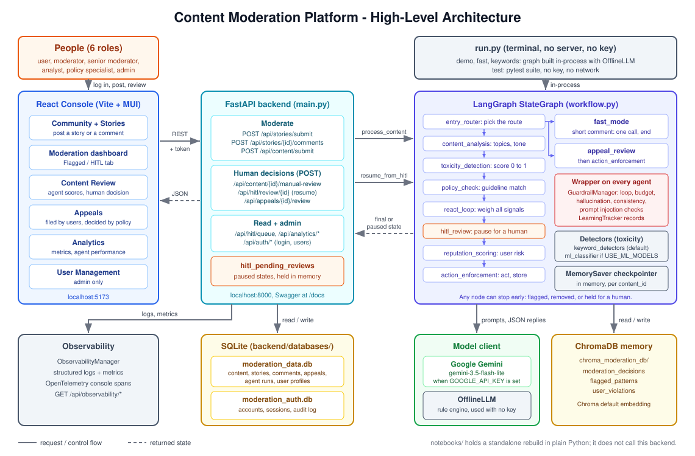

# Content Moderation & Community Safety Platform

[](LICENSE)
[](https://www.python.org/)
[](https://nodejs.org/)
[](#run-it)

A multi-agent system that **moderates posts and comments, and holds the hard cases
for a human**. A LangGraph graph sends each post through specialist agents: content
analysis, toxicity, policy, a ReAct step that weighs all their signals, user
reputation, and enforcement. Short comments can take a one-call fast path instead.
Low-confidence or high-impact cases stop for a moderator, and users can appeal.

It runs against a small community site you start locally: stories, comments, and six
user roles. React console, FastAPI backend, Google Gemini, and an offline rule engine
when no key is set.



---

## Run it

No API key, no Node and no database setup for this first path. It runs the real
moderation graph against **OfflineLLM**, a deterministic rule engine that answers the
prompts the agents send. It is not a model and the output says so.

You need [Python 3.12+](https://www.python.org/downloads/) and
[git](https://git-scm.com/downloads). Node.js 22.12+ is only needed for the full stack.

```bash
git clone https://github.com/genieincodebottle/aiml-companion.git
cd aiml-companion/projects/agentic-ai/content-moderation-project

cd backend
pip install uv
uv venv
source .venv/bin/activate        # Windows: .venv\Scripts\activate
uv pip install -r requirements.txt
cd ..

python run.py demo
```

Six posts are moderated and a results table appears. One post is handled by a single
agent, others by four, five or six, and the last two posts are the same sentence with
different outcomes, because the accounts behind them differ.

| Command | What it does |
|---|---|
| `python run.py demo` | Six posts through the full graph, fast path off |
| `python run.py fast` | The same posts through the single-call fast path |
| `python run.py keywords` | What the keyword layer alone scores, and where it is wrong |
| `python run.py test` | The test suite (54 tests, no key, no network) |
| `python run.py serve` | Starts the API on port 8000 |

Add `-v` to any of them to see the agents' own logs. SQLite and Chroma files are
created under `backend/databases/` on first run. None are committed to the repo.

**Prefer a notebook?** [`notebooks/content_moderation_standalone.ipynb`](notebooks/content_moderation_standalone.ipynb)
rebuilds the same ideas in standard-library Python with nothing to install:
[Open in Colab](https://colab.research.google.com/github/genieincodebottle/aiml-companion/blob/main/projects/agentic-ai/content-moderation-project/notebooks/content_moderation_standalone.ipynb)
or [open on Kaggle](https://www.kaggle.com/code/genieincodebottle/content-moderation-multi-agent).

### Full stack: two terminals

The React console, the API and the databases. This also works without a key: the
agents fall back to OfflineLLM.

```bash
# Terminal 1: backend on http://localhost:8000 (venv from above still active)
cd backend
cp .env.example .env                 # Windows: copy .env.example .env
python scripts/initialize_users.py   # creates the 11 demo accounts below
python main.py
```

`python main.py` starts uvicorn on port 8000 with auto-reload. Open
http://localhost:8000/docs to check the API is up.

```bash
# Terminal 2: console on http://localhost:5173
cd frontend
npm install
npm run dev
```

Open **http://localhost:5173** and log in with one of these accounts:

| Username | Password | Role | What you can do |
|---|---|---|---|
| `raj`, `priya`, `amit` | `test@123` | User | Post stories and comments, file appeals |
| `moderator1`, `moderator2` | `mod@123` | Moderator | Moderation dashboard, content review |
| `senior_mod`, `hitl_reviewer` | `senior@123`, `hitl@123` | Senior Moderator | Flagged and held items, escalations |
| `analyst` | `analyst@123` | Content Analyst | Analytics |
| `policy_expert`, `appeals_handler` | `policy@123`, `appeals@123` | Policy Specialist | Appeals review |
| `admin` | `admin@123` | Admin | Everything, plus user management |

The registration form creates new accounts with the `user` role. These are demo
credentials, defined in [`backend/scripts/initialize_users.py`](backend/scripts/initialize_users.py).

### Your first moderation

1. Log in as `raj` / `test@123`. On **Community**, click **Share Your Story**, write a
   friendly story and click **Publish Story**. It is approved and appears in the feed.
2. Publish a second story with an insult in it, for example *"You are all worthless
   idiots and I hope every one of you gets hurt."* In offline mode it is flagged by
   the first agent and kept out of the public feed. You can still see it in your own
   stories, under review.
3. Log out and log in as `senior_mod` / `senior@123`. Open **Moderation** and the
   **Flagged / HITL** tab. Open the item to see each agent's score and reasoning.
4. Click **Approve**, **Warn** or **Remove** and confirm in the dialog. The decision
   is saved and the story's status changes for the author. If the item was paused for a
   human, this resumes the graph (`POST /api/hitl/review/{id}`). Senior moderators and
   above also have a **Review Queue** page in the menu that lists every paused item.
5. Comment on a story with a short line. Comments of 200 characters or less take the
   fast path: one model call instead of the full graph.

### Use real Gemini (optional)

Get a free key at <https://aistudio.google.com/app/apikey>, then open `backend/.env`
and paste it after `GOOGLE_API_KEY=`. Restart the backend. The agents now call
`gemini-3.5-flash-lite` (set as `MODEL_NAME` in `backend/src/agents/agents.py`).

| Variable (`backend/.env`) | Default | What it does |
|---|---|---|
| `GOOGLE_API_KEY` | empty | Gemini key. Empty means offline mode. |
| `MODERATION_OFFLINE` | `false` | `true` forces offline mode even with a key |
| `ENABLE_FAST_MODE` | `true` | Single-call path for short comments |
| `FAST_MODE_MAX_LENGTH` | `200` | Longest text, in characters, that takes the fast path |
| `FAST_MODE_CONTENT_TYPES` | `story_comment` | Content types allowed on the fast path |
| `USE_ML_MODELS` | `false` | Adds the HateBERT/DistilBERT classifier to toxicity scoring |
| `ML_PRIMARY_MODEL`, `ML_USE_ENSEMBLE`, `ML_PRELOAD_MODELS`, `ML_DEVICE` | see `.env.example` | Classifier options |

The classifier needs `uv pip install -r requirements-ml.txt` first (torch and
transformers are not in the default requirements), and it downloads about 500 MB of
model files on first use.

**Turn fast mode on with care.** The fast path never loads user reputation and never
checks a HITL trigger, so it cannot suspend a repeat offender or hold a high-profile
account for review. Compare `python run.py demo` with `python run.py fast` to see it.

---

## How one post runs

A story submitted from the console, traced through the boxes in the diagram:

1. **Console.** `CommunityDashboard.jsx` sends `POST /api/stories/submit` through the
   axios client in `frontend/src/services/api.js`.
2. **API.** `submit_story` in `backend/main.py` loads or creates the user profile,
   builds the initial `ContentState`, records the submission in `moderation_data.db`,
   and calls `process_content()` from `backend/src/agents/workflow.py`.
3. **Route.** `entry_router` picks the start: `appeal_review` for an appeal, `fast_mode`
   for a short comment, `content_analysis` for everything else.
4. **Analyse.** `content_analysis` extracts topics and checks Chroma for similar past
   content. If it flags the post, the graph stops here and the post goes to the
   moderators.
5. **Score.** `toxicity_detection` computes a toxicity score in code
   (`keyword_detectors.py`, plus `ml_classifier.py` when enabled). The model then
   reads the post for context such as quotation, satire or education, and decides
   approve, flag or remove.
6. **Check policy.** `policy_check` maps the post against the community guideline
   categories in `backend/src/core/models.py`.
7. **Weigh.** `react_loop` combines the three decisions with fixed weights (policy
   0.40, toxicity 0.35, content 0.25) and checks the HITL triggers.
8. **Hold for a human, if needed.** `hitl_review` sets `pending_human_review` with a
   priority. The API keeps the paused state in `hitl_pending_reviews`. A moderator's
   decision in the console (`POST /api/hitl/review/{id}`) resumes the graph from there
   with `resume_from_hitl`.
9. **Reputation and action.** `reputation_scoring` reads the user's history from
   Chroma and decides the user-level step (warn, suspend, ban).
   `action_enforcement` writes the outcome and stores the decision in Chroma for
   future similar-case lookups.
10. **Back to the API.** `submit_story` saves the status, creates the story record
    (visible only if approved) and returns the result to the console.

Every agent node runs inside a wrapper in `workflow.py` that checks the guardrails
before the agent and records the decision for learning after it.

### What sends a post to a human

`_evaluate_hitl_triggers` in `backend/src/agents/agents.py` checks seven triggers. Each
adds a weight, and the total sets the priority (`HITL_CONFIG` in
`backend/src/core/models.py`).

| Trigger | Fires when | Weight |
|---|---|---|
| `high_severity` | the policy violation is high or critical | 80 |
| `first_offense_severe` | a first-time user posts toxicity above 0.7 or a severe violation | 70 |
| `high_profile_user` | the account is verified or has 10,000+ followers | 60 |
| `sensitive_content` | the post touches a sensitive topic | 50 |
| `potential_false_positive` | the signals suggest the flag may be wrong | 45 |
| `conflicting_decisions` | the three agents agree weakly | 40 |
| `low_confidence` | average agent confidence is below 0.70 | 30 |

Priority is **critical** at 100 or more, **high** at 75, **medium** at 50, and **low**
below that.

---

## The one rule

> **Code scores the toxicity. The model judges the context.**

Every toxicity number is computed before a model is consulted, by the keyword
detector or the optional classifier. The model's job is the part a word list cannot
do: telling an insult from a history lesson that quotes one. That split is also why
the offline mode is honest. OfflineLLM calls the same keyword detectors, so the
scores you see offline are the scores the real pipeline computes. Run
`python run.py keywords` to see where the word list alone goes wrong.

---

## The six demo posts

`python run.py demo` runs these through the graph with OfflineLLM. Results from the
current code:

| Post | What it tests | Outcome | Agents |
|---|---|---|---|
| A thank-you note | the plain path | approved | 5 |
| "Hello everyone, I am grateful..." | the old substring bug ("hell" in "Hello") | approved, score 0.00 | 5 |
| An insult with a threat | early exit | flagged by `content_analysis`, sent to moderators | 1 |
| A documentary about a massacre | toxic words, innocent use | approved, keyword score 0.30 | 5 |
| A mild insult from a repeat offender | reputation | removed, account suspended | 6 |
| The same insult from a verified 50k-follower account | HITL trigger | held for a human | 4 |

The last two rows are the point of the demo: the same sentence gets different
outcomes because the account behind it differs. `python run.py fast` runs the same
posts through the fast path, where both are approved, because that path never sees
the account.

**Tests.** `python run.py test` runs 54 tests with no key and no network
(`backend/tests/test_offline_mode.py`, `backend/tests/test_react_loop.py`,
`backend/tests/test_console_wiring.py`). The last one drives the API the console calls,
against temporary databases.
`backend/tests/test_e2e.py` is a separate script that drives a running server on
port 8000. Pytest skips it.

---

## What this is, and what it is not

A **reference implementation for learning**. It shows a routed multi-agent graph,
human review, appeals and memory in one working app. It is not a production
moderation system. Gaps found in the code:

- **Paused state lives in memory.** `hitl_pending_reviews` and the `MemorySaver`
  checkpointer are lost when the backend restarts. A paused item then returns 404 from
  the resume endpoint, and the console records the moderator's decision directly instead.
- **Some `HITL_CONFIG` keys are not read.** `agent_agreement_threshold`,
  `veteran_user_threshold_days`, `auto_approve_conditions` and every checkpoint except
  `post_react` appear in `/api/hitl/config` but no code uses them. The triggers and
  priority levels in the table above are the ones that run.
- **Most endpoints do not check the login token.** The decision endpoints do: manual
  review, graph resume, run-moderation, user status and the HITL queue delete need a
  moderator session, and reviewing an appeal needs a policy specialist or admin. Content
  submission, reading, and the other endpoints are open, and role limits on the
  moderation pages are enforced in the React router. CORS allows every origin. This is a
  demo: put real authentication and a fixed origin list in front of it before any use
  beyond a laptop.
- **An appeal gets a recommendation, not a decision.** `POST /api/appeals/submit` runs
  the Appeal Review Agent and stores its opinion with the content's agent decisions,
  but the appeal stays pending until a person decides in `/api/appeals/{id}/review`.
  That human outcome is passed to `LearningTracker.record_appeal`.
- **"Learning" is recorded, not applied.** `LearningTracker` keeps per-agent memory in
  the process, so it is lost on restart. Appeal outcomes are recorded there, and no
  agent reads them back when it decides.
- **Guardrails warn, they do not stop.** A failed check is recorded in the state and
  lowers confidence, and the agent still runs. This is deliberate, and the course module
  on guardrails teaches it. The budget guard counts a fixed estimate per agent call, not
  real token usage.
- **Model output is parsed, not enforced.** Agents ask for JSON and parse it with
  `parse_llm_response`. A reply that does not parse falls back to a default decision.

---

## Troubleshooting

| Symptom | Fix |
|---|---|
| `ModuleNotFoundError` when starting the backend | Run from `backend/` with the venv active, then `uv pip install -r requirements.txt` again |
| Console shows "Network Error" | Start the backend first. The console talks to port 8000 by default, and `frontend/.env.example` sets the same. |
| "Database is locked" | Close any SQLite viewer that has a file in `backend/databases/` open |
| Chroma errors on startup | Delete `backend/databases/chroma_moderation_db/` and restart. It is recreated. |
| A flagged story is missing from the feed | By design. Only approved stories are public. |
| "Invalid API Key" from Gemini | Check `GOOGLE_API_KEY` in `backend/.env`, or leave it empty for offline mode |
| `npm install` fails with syntax errors | Check `node --version`. Vite 8 needs Node 22.12+ (or 20.19+). |
| Port 8000 or 5173 is taken | macOS/Linux: `lsof -i :8000`, then `kill <PID>`. Windows: `netstat -ano \| findstr :8000`, then `taskkill /PID <PID> /F`. |
| `.venv\Scripts\activate` is blocked on Windows | In PowerShell: `Set-ExecutionPolicy -ExecutionPolicy RemoteSigned -Scope CurrentUser` |

### Reset the data

```bash
cd backend
python scripts/cleanup_data.py        # asks you to type DELETE ALL
python scripts/initialize_users.py    # recreate the demo accounts
```

`cleanup_data.py` removes all content, decisions, appeals, accounts, sessions and the
Chroma store. To clear only the Chroma store, delete
`backend/databases/chroma_moderation_db/`.

---

## Learn more

| If you want to... | Read |
|---|---|
| Build this project step by step | [Content Moderation System on AI-ML Companion](https://aimlcompanion.ai/module/aiAgents/contentModerationProject) |
| See sequence diagrams for stories, comments, appeals and HITL | [END_TO_END_ARCHITECTURE.md](END_TO_END_ARCHITECTURE.md) |
| Know what each database file holds | [backend/databases/README.md](backend/databases/README.md) |
| Read about the console code | [frontend/README.md](frontend/README.md) |
| Step through the ideas with no install | [notebooks/](notebooks/) |
| Work on this code with Claude Code | [CLAUDE.md](CLAUDE.md) and [.claude/](.claude/), explained in [How to Run Claude Code Cheaply on a Big Codebase](https://aimlcompanion.ai/blog/run-claude-code-cheaply-big-codebase-2026) |

The concepts behind it each have a module on AI-ML Companion:
[LangGraph Agents](https://aimlcompanion.ai/module/aiAgents/langgraphAgents),
[Agent Safety & Guardrails](https://aimlcompanion.ai/module/aiAgents/agentGuardrails),
[Agent Memory Systems](https://aimlcompanion.ai/module/aiAgents/agentMemory),
[Multi-Agent Design Patterns](https://aimlcompanion.ai/module/aiAgents/multiAgentPatterns),
[Full-Stack GenAI Application](https://aimlcompanion.ai/module/aiAgents/agentFullStack) and
[Structured Outputs](https://aimlcompanion.ai/module/aiAgents/structuredOutputs).

---

## Project layout

```
run.py                     offline demo, fast path, keyword view, tests, serve
backend/
  main.py                  FastAPI app: REST endpoints, startup, in-memory HITL store
  src/agents/workflow.py   the LangGraph StateGraph: nodes, routing, wrapper
  src/agents/agents.py     the agent functions and the HITL trigger rules
  src/agents/llm_offline.py  OfflineLLM, the no-key rule engine
  src/core/                ContentState, enums, thresholds, Pydantic reply schemas
  src/database/            SQLite access: moderation data, auth
  src/memory/              ChromaDB memory manager, LearningTracker
  src/ml/                  keyword detectors, optional classifier, guardrails
  src/utils/               toxicity helpers, observability, evaluation
  scripts/                 initialize_users.py, cleanup_data.py
  tests/                   offline tests, plus test_e2e.py for a live server
frontend/                  React 19 + Vite + MUI console
notebooks/                 standalone notebook, standard library only
docs/                      high-level architecture diagram
images/                    diagrams used by END_TO_END_ARCHITECTURE.md
```

## License

MIT. See [`LICENSE`](LICENSE).
