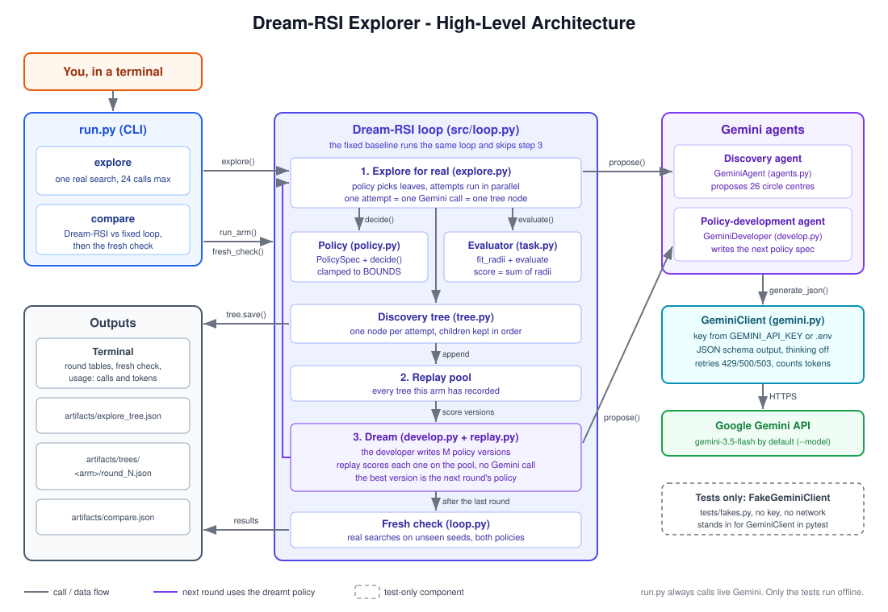

# Dream-RSI Explorer

[](LICENSE)
[](https://www.python.org/)
[](https://ai.google.dev/)

Search loops like FunSearch and AlphaEvolve keep the model fixed and let it propose,
score and build on ideas. Something still has to decide **where to search next**, and
that rule is usually hand-written and never learns.
[Dream-RSI (Zheng et al., 2026)](https://arxiv.org/html/2609.14858v1) makes that rule
learn by **replaying recorded searches instead of paying for new ones**. The paper
ships no code. This project implements the loop.

It runs against one of the paper's own benchmarks, packing 26 circles in a square,
with live Gemini calls. A Python CLI, the `google-genai` SDK, and uv.

> **Blog post:** [How Dream-RSI lets an AI agent improve how it searches](https://aimlcompanion.ai/blog/dream-rsi-recursive-self-improvement-explained-2026).
> Read it first for the big picture, what the paper claims, and where the idea breaks down.



<details>
<summary><strong>New to the terms?</strong></summary>

- **Discovery agent.** Gemini, proposing where to put 26 circles in a square.
- **Evaluator.** Code that scores a layout, the sum of the radii.
- **Discovery tree.** The record of one search. Each node is one attempt, linked to the attempt it grew from.
- **Exploration policy.** Decides which attempts to build on, how many to run in parallel, and when to stop.
- **Replay.** Walking a recorded tree with a new policy. Picking a node returns what was recorded there, with no Gemini call.
- **Dreaming.** Gemini writes new policy versions, replay scores them, and the best one runs next.

</details>

---

## Run it

There is **no offline mode**: `explore` and `compare` always call the live Gemini API,
so you need a key. The test suite is the exception. It uses a fake Gemini client and
runs with no key and no network.

The project uses [uv](https://docs.astral.sh/uv/) to install Python and every package,
so there is no virtual environment to create or activate by hand. There is no Docker
setup and no server: everything runs from one terminal.

### 1. What you need

| | How to check |
|---|---|
| Git | `git --version` |
| uv | `uv --version` (install it in step 2 if this fails) |
| A Gemini API key | Create one at [Google AI Studio](https://aistudio.google.com/apikey) |

You don't need to install Python yourself. uv downloads a suitable version (3.12 or
newer, from `pyproject.toml`) if your machine doesn't have one.

### 2. Install uv

**Windows (PowerShell)**

```powershell
powershell -ExecutionPolicy ByPass -c "irm https://astral.sh/uv/install.ps1 | iex"
```

**macOS and Linux**

```bash
curl -LsSf https://astral.sh/uv/install.sh | sh
```

Then **close the terminal and open a new one**, so it can find the `uv` command, and
check with `uv --version`.

### 3. Get the code and install

```bash
git clone https://github.com/genieincodebottle/aiml-companion.git
cd aiml-companion/projects/agentic-ai/dream-rsi-explorer
uv sync
```

No Git? On the [repository page](https://github.com/genieincodebottle/aiml-companion),
choose **Code**, then **Download ZIP**, unzip it, and open a terminal in the
`projects/agentic-ai/dream-rsi-explorer` folder before running `uv sync`.

`uv sync` creates a `.venv` folder in the project and installs the exact package
versions pinned in `uv.lock`, including pytest. Every command below runs from this
folder and starts with `uv run`, which uses that environment automatically.

### 4. Add your API key

Create a file named `.env` in the `dream-rsi-explorer` folder with one line.

```
GEMINI_API_KEY=paste-your-key-here
```

**Windows (PowerShell)**

```powershell
Set-Content -Path .env -Value "GEMINI_API_KEY=paste-your-key-here"
```

**macOS and Linux**

```bash
echo "GEMINI_API_KEY=paste-your-key-here" > .env
```

`GOOGLE_API_KEY` works too, and so does an environment variable instead of a file.
`src/gemini.py` checks the environment first, then looks for a `.env` in this folder
and each parent folder, so a key at the repository root also works. It reads `.env`
files saved as UTF-16 or with a byte-order mark, which is what PowerShell and Notepad
can produce. `.env` is in `.gitignore`, so your key is never committed.

### 5. Check the setup

```bash
uv run pytest
```

You should see `34 passed`. This step makes no API calls.

### 6. Your first run

```bash
uv run python run.py explore
```

This runs one real search with the hand-written policy, capped at 24 Gemini calls.
You will see one progress line per round, then a summary:

```
policy          w2 a2 r1 p6 stop+0 s6 R6
rounds          6
Gemini calls    24  (24 valid layouts)
best score      2.5094   (best known for 26 circles is about 2.635)
best by round   2.500 2.500 2.509 2.509 2.509 2.509
tree saved to   artifacts/explore_tree.json
```

That is the measured run from [docs/results.md](docs/results.md). A live model answers
differently each time, so your numbers will differ. The last line is a usage line with
the call and token counts.

Then run the full loop:

```bash
uv run python run.py compare
```

`compare` prints the most calls it could make before it starts (276 with the
defaults), and the real call and token counts when it ends. The measured run made
175 calls. Full results are saved to `artifacts/compare.json`.

### 7. Change the model and limits (optional)

Every command accepts `--help`, for example `uv run python run.py compare --help`.
Options work before or after the command name.

| Option | Default | What it does |
|---|---|---|
| `--model` | `gemini-3.5-flash` | Gemini model for both agents |
| `--max-calls` | `24` | Gemini-call cap for one search |
| `--workers` | `8` | parallel Gemini calls; lower it if you hit rate limits |
| `--seed` | `7` | seed for the search and the fresh-check seeds |
| `-q`, `--quiet` | off | hide progress lines |
| `--rounds` (compare) | `3` | online rounds per arm |
| `--versions` (compare) | `4` | policy versions Gemini writes per dreaming phase |
| `--beta1` / `--beta2` (compare) | `0.004` / `0.002` | replay penalty per call, reward per call per round |
| `--fresh-seeds` (compare) | `3` | real searches per policy in the final check |

### If something goes wrong

| You see | Fix |
|---|---|
| `uv` is not recognised | Close the terminal and open a new one after installing uv. If it still fails, run the install command from step 2 again |
| `No GEMINI_API_KEY found` | The `.env` file is missing or in the wrong folder. It must sit next to `run.py` (or in a parent folder) |
| `429` or `RESOURCE_EXHAUSTED` | You hit a rate limit, common on the free tier. Add `--workers 2` to slow down. The client already retries these with backoff, up to 5 attempts per call |
| `404` or model not found | The default model isn't available to your key. Pass another one, for example `--model gemini-flash-latest` |
| `No module named ...` | You ran `python` directly. Start the command with `uv run`, or run `uv sync` again |
| `google-genai is not installed. Run: uv sync (from this folder)` | The dependencies are not installed yet. Run `uv sync` in this folder |
| `hit max_output_tokens ... response is a fragment` | The model's answer was cut off. That attempt or policy version is recorded as failed and the run continues |
| Nothing prints for a while | Each round waits for all of its Gemini calls. A progress line appears after every round |

---

## How one run works

The loop the paper describes, and the file for each stage:

```
 1. EXPLORE for real: the policy steers Gemini, every attempt is a tree node
        |
 2. ADD the tree to the replay pool
        |
 3. DREAM: Gemini writes policy versions, replay scores them, keep the best
        |
        +--> the best version runs the next round (back to 1)
 after the last round: FRESH CHECK on unseen seeds
```

One `compare` run, step by step:

1. **`run.py`** parses the options and builds a `GeminiClient` (`src/gemini.py`),
   which finds your key. It prints the call cap, then creates the two agents: the
   discovery agent `GeminiAgent` (`src/agents.py`) and the policy-development agent
   `GeminiDeveloper` (`src/develop.py`).
2. **Round 0, shared.** Both arms start with the same hand-written policy
   (`HAND_WRITTEN` in `src/policy.py`), so `run.py` runs one round-0 search with
   `explore()` and gives it to both arms instead of paying for two.
3. **One search** (`src/explore.py`). Each round, `decide()` in `src/policy.py` looks
   at the current leaves and returns which nodes to build on and how many attempts
   from each. Attempts run in parallel on a thread pool. Each attempt is one Gemini
   call: the discovery agent sees the parent layout, its score and the evaluator's
   notes, and returns 26 centres as JSON. `fit_radii()` in `src/task.py` fits the
   radii in code, `evaluate()` scores the layout, and the result is added to the
   `DiscoveryTree` (`src/tree.py`) in submission order. The search stops when the
   policy says so or the call cap is reached.
4. **`run_arm()`** (`src/loop.py`) adds each round's tree to that arm's replay pool
   and saves it to `artifacts/trees/<arm>/round_N.json`.
5. **Dreaming** (dream arm only). `dream()` in `src/develop.py` scores the current
   policy on the pool with `score_on_pool()` (`src/replay.py`). Then, up to
   `--versions` times, the developer reads every version tried so far with its replay
   statistics and writes one new policy spec. The spec is clamped to `BOUNDS`,
   duplicates are skipped, and replay scores it. Replay never calls Gemini: picking a
   node returns its next **recorded** child, or nothing. The highest-scoring version,
   which can be the current one, becomes the next round's policy.
6. **The fixed arm** (Recursive Fixed Exploration) runs the same rounds on the same
   seeds and skips step 5, so the only difference between the arms is whether the
   policy learns.
7. **Fresh check.** `fresh_check()` runs real searches on seeds neither arm used,
   once with the hand-written policy and once with the final dreamt policy, and
   reports the same objective dreaming optimised.
8. `run.py` prints the round table, the dreaming notes, the fresh-check table and the
   usage line, and writes `artifacts/compare.json`.

The replay score, from the paper:

```
V = best score found - beta1 * attempts revealed + beta2 * attempts / rounds
```

---

## The one rule

> **Gemini proposes. Code scores, bounds and replays.**

Each rule is enforced in code, not in a prompt:

- **Scoring** happens in `task.evaluate`, outside the agent, so the agent never grades
  its own work.
- **Geometry** is code. Gemini returns centres only and `fit_radii` computes radii
  that are always valid. Asked for full layouts, Gemini got 1 valid answer in 6;
  asked for centres, 6 in 6 ([docs/results.md](docs/results.md)).
- **Policy edits** are a spec of eight knobs, clamped to `BOUNDS` in `src/policy.py`.
  The project never runs code a model wrote.
- **Replay** only reveals attempts that were really recorded. It never invents a
  result, and dreaming can always fall back to the current policy, so it never picks
  a version that scores worse on replay.
- **Truncated answers** raise instead of returning, so a cut-off layout counts as a
  failed call, not as a bad idea.

---

## Results

### Reading the output

A policy prints as a short label.

```
w2 a2 r1 p6 stop+0 s6 R6
```

| Part | Meaning |
|---|---|
| `w2` | continue from the 2 best leaves each round |
| `a2` | 2 parallel attempts from each of those leaves |
| `r1` | 1 fresh start from scratch each round |
| `p6` | after 6 rounds with no improvement, the search counts as stalled |
| `stop+0` | when stalled, stop (or `widen`, `restart`), with a boost of 0 |
| `s6` | stop after 6 stalled rounds in a row |
| `R6` | at most 6 rounds |

### The measured comparison

`compare` ends with the fresh check, real searches on seeds neither side saw during
the loop. The measured run (`gemini-3.5-flash`, 2026-09-17, 3 rounds, 4 versions,
3 fresh seeds):

```
              policy                              best   calls    value
hand-written  w2 a2 r1 p6 stop+0 s6 R6          2.5033    24.0   2.4153 +/- 0.0033
dream final   w1 a1 r1 p1 stop+0 s1 R3          2.4868     3.7   2.4752 +/- 0.0082

Replay predicted 2.4751 for the final policy. Real runs gave 2.4752.
```

- **best** is the best sum of radii found. The best known for 26 circles is about 2.635.
- **calls** is Gemini calls per search.
- **value** is what dreaming optimises, `best - 0.004 * calls + 0.002 * calls per round`. Higher is better.

The learned policy used about 6.5 times fewer calls for a slightly lower best score,
and won on value. Gemini's first layout was already close to the best it would find,
and the recorded trees showed it: most calls arrived after the last improvement.
Replay was accurate here because the final policy only uses the first few attempts of
each search, which every recorded tree contains. A policy that searched wider than
the recordings would get a less reliable prediction.

Full output, the round-by-round table and the caveats are in
[docs/results.md](docs/results.md).

---

## What this is, and what it is not

A **working implementation of the Dream-RSI loop for learning**, on one task and one
model. It is enough to watch the mechanism work. It is not a benchmark, and it does
not reproduce the paper's results.

| Paper | This project | Why |
|---|---|---|
| An LLM rewrites executable policy code | Gemini edits an eight-knob policy spec, clamped to bounds | The project never runs code a model wrote |
| LLM coding agents on engineering tasks | 26-circle packing, one of the paper's maths benchmarks | Exact scoring in microseconds |
| The model writes whole solutions | Gemini proposes centres, code fits the radii | Asked for full layouts, Gemini got 1 in 6 valid. Centres only, 6 in 6 |
| Many rounds, many tasks | 3 rounds, 3 fresh seeds per policy by default | Keeps the number of Gemini calls small |

Other limits:

- **A live model is not deterministic.** Two arms on the same seed still see
  different answers, which is why the final word goes to the fresh check.
- **The result depends on the model and the task.** A strong first answer leaves
  little for search to add, so the learned policy spends little. With a weaker model,
  or a task where progress keeps coming, the same loop would learn to keep searching.
  Raise `--beta1` and calls matter more; lower it and quality matters more.
- **`fit_radii` is a greedy fit**, not the optimal solution for given centres.
- **No offline mode.** Only the tests run without a key.

---

## Learn more

| If you want to... | Read |
|---|---|
| Get the big picture and the paper's claims | [the blog post](https://aimlcompanion.ai/blog/dream-rsi-recursive-self-improvement-explained-2026) |
| See every measured number and the command that made it | [docs/results.md](docs/results.md) |
| Read the paper | [arXiv:2609.14858](https://arxiv.org/html/2609.14858v1) |
| Change the policy knobs or their bounds | [`src/policy.py`](src/policy.py) |
| See how replay reveals recorded children | [`src/replay.py`](src/replay.py) |

---

## Project layout

```
run.py              CLI: explore, compare
src/task.py         circle packing evaluator and radius fitting
src/tree.py         discovery tree, saved as JSON
src/policy.py       policy spec, bounds and the decide() function
src/agents.py       Gemini discovery agent
src/explore.py      stage 1, online exploration
src/replay.py       replay simulator and replay score
src/develop.py      stage 3, Gemini policy-development agent
src/loop.py         Dream-RSI, the fixed baseline, and the fresh check
src/gemini.py       Gemini client, key loading, retries, token counts
tests/              34 tests with a fake Gemini client (tests/fakes.py)
docs/               measured results and the architecture diagram
artifacts/          run outputs (trees, compare.json), not committed
pyproject.toml      dependencies, installed by uv sync
uv.lock             exact pinned versions
```

## Reference

Zheng et al., 2026. [Dream-RSI: Recursive Self-Improvement through Evolving Worlds](https://arxiv.org/html/2609.14858v1). arXiv:2609.14858.

## License

MIT. See [LICENSE](LICENSE).
