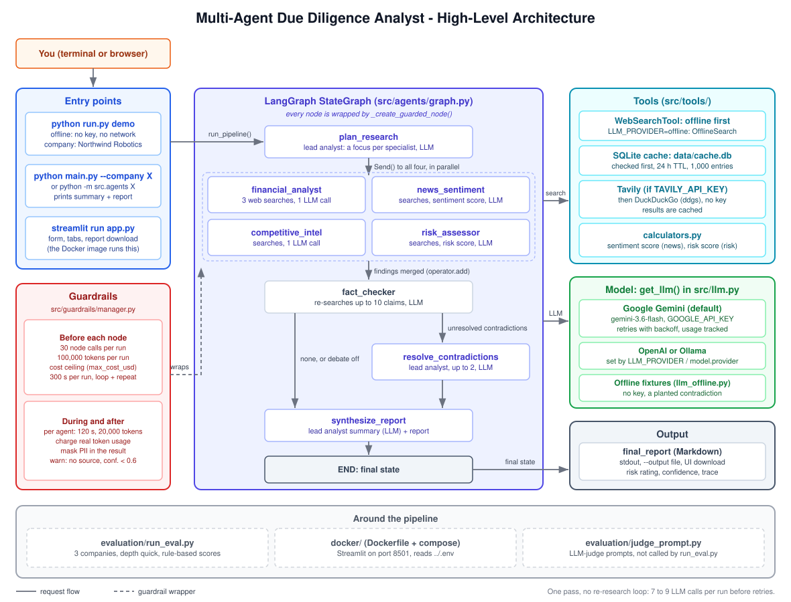

# Multi-Agent Due Diligence Analyst

[](#license)
[](https://www.python.org/)
[](#run-it)

Give it a company name and six agents research it. A lead analyst plans the work, four
specialists (financial, news and sentiment, competitive, risk) search the web in
parallel, a fact checker re-searches their key claims, and the lead analyst settles the
contradictions it finds before writing the report. **Every node runs inside a guardrail
wrapper** that charges the real token usage, enforces time and token ceilings, masks PII
and flags low-confidence findings.

It runs against Google Gemini with web search through Tavily or DuckDuckGo, or fully
offline with fixtures that disagree on purpose. Python, LangGraph, Streamlit.

> Build it step by step on [AI-ML Companion](https://aimlcompanion.ai/module/aiAgents/dueDiligenceProject):
> guided walkthroughs, architecture decisions and hands-on challenges.



---

## Run it

No API key and no network needed. `python run.py demo` sets `LLM_PROVIDER=offline`: every
agent gets a schema-valid reply from a fixture in `src/llm_offline.py`, and search returns
fixture results. The fixtures **disagree**: the financial analyst reports revenue growth
accelerating while the news agent reports guidance withdrawn in the same quarter. So the
fact checker flags contradictions and the debate step runs. A demo where all six agents
agree would exercise the graph and show nothing.

You need [Python 3.12+](https://www.python.org/downloads/) and
[git](https://git-scm.com/downloads), or [Docker](https://www.docker.com/products/docker-desktop/)
for the app.

```bash
git clone https://github.com/genieincodebottle/aiml-companion.git
cd aiml-companion/projects/agentic-ai/due-diligence-agent

python -m venv .venv
source .venv/bin/activate        # Windows: .venv\Scripts\activate
pip install -r requirements.txt

python run.py demo
python run.py test               # 125 tests, no key, no network
```

`run.py` needs no `make`. Its commands: `demo [company]`, `analyse` (passes its arguments
to `main.py`), `ui` (`streamlit run app.py`) and `test` (`pytest`).

### Option A: Docker (one command)

```bash
cp .env.example .env              # Windows PowerShell: copy .env.example .env
# put your GOOGLE_API_KEY in .env, or add LLM_PROVIDER=offline to run with no key
cd docker && docker compose up --build
```

Open **http://localhost:8501**. Compose builds `docker/Dockerfile`, reads `../.env`,
and mounts `artifacts/reports` and `data` (the search cache). Without compose:
`docker build -f docker/Dockerfile -t due-diligence-agent .` then
`docker run -p 8501:8501 --env-file .env due-diligence-agent` (also `make docker-build`
and `make docker-run`).

### Option B: from the terminal

```bash
python main.py --company "Tesla"                                   # needs a key, see below
python main.py --company "Stripe" --depth deep --query "fintech regulation risks"
python main.py --company "OpenAI" --depth quick --output reports/openai.md
python -m src.agents "Databricks" --depth standard                 # same pipeline
streamlit run app.py                                               # the dashboard
```

`main.py --stage` picks `analyze` (the default), `ui` or `evaluate`. `--depth` (`quick`,
`standard`, `deep`) goes into the planner's prompt; it does not change the number of
searches or LLM calls. With `make`: `make install`, `make test`, `make test-cov`,
`make analyze`, `make ui`, `make evaluate`, `make lint`.

### Your first analysis

1. Run `python run.py demo`. The log lines show each node start and finish: the plan,
   the four specialists, the fact checker, the debate and the synthesis.
2. The summary for the offline company, Northwind Robotics, reads
   `Status: complete`, `Risk Rating: high`, `Confidence: 68%`.
3. In the log: the fact checker verified 4 of 7 claims and found 3 contradictions, and
   the debate resolved 2 of them (`pipeline.max_debate_rounds: 2`).
4. Then the report: a verdict ("Real but low-quality growth, and the disagreement between
   the numbers and the guidance is the finding."), strengths, risks, uncertainties and
   next steps.
5. In the app (`python run.py ui`), type a company, pick a depth and click
   **Run Due Diligence Analysis**. The result has four tabs: **Full Report**,
   **Findings by Agent**, **Execution Trace** and **Raw Data**, and a Markdown download.

### Use real Gemini (optional)

Get a key at <https://aistudio.google.com/apikey>, then:

```bash
cp .env.example .env      # Windows PowerShell: copy .env.example .env
# open .env and replace the placeholder after GOOGLE_API_KEY=
```

`main.py` and `app.py` load `.env`; the app also takes the key in its sidebar. Search
needs no key: it uses Tavily when `TAVILY_API_KEY` is set and DuckDuckGo otherwise.
`python run.py analyse --company X` loads `.env` first, then checks for a usable key
(a placeholder such as `your_key_here` does not count), so a key that lives only in `.env`
works there too.

| Env variable | Config path | Default |
|---|---|---|
| `GOOGLE_API_KEY` (or `GEMINI_API_KEY`) | - | required unless offline |
| `TAVILY_API_KEY` | - | optional, DuckDuckGo otherwise |
| `LLM_PROVIDER` | `model.provider` | `google` (`openai`, `ollama`, `offline`) |
| `DD_MODEL_PROVIDER` | `model.provider` | `google` |
| `DD_MODEL_NAME` | `model.name` | `gemini-3.6-flash` |
| `DD_MODEL_TEMPERATURE` | `model.temperature` | `0.1` |
| `DD_MAX_TOTAL_TOKENS` | `budget.max_total_tokens` | `100000` |
| `DD_MAX_COST_USD` | `budget.max_cost_usd` | set in `configs/base.yaml` |
| `DD_SEARCH_PROVIDER` | `search.provider` | `tavily` |
| `DD_CACHE_ENABLED` | `cache.enabled` | `true` |
| `DD_LOG_LEVEL` | `logging.level` | `INFO` |

Everything else is in [`configs/base.yaml`](configs/base.yaml).

---

## How one analysis runs

The graph is wired in [`src/agents/graph.py`](src/agents/graph.py); `run_pipeline()` is the
entry every interface calls.

1. **Start.** `run_pipeline(company, query, depth)` resets the `GuardrailManager`
   ([`src/guardrails/manager.py`](src/guardrails/manager.py)), builds the graph and
   invokes it with `default_state()` ([`src/models/state.py`](src/models/state.py)).
2. **Guarded nodes.** Every node is wrapped by `_create_guarded_node()`. Before the agent
   runs, `pre_check()` refuses it if the run has used 30 node calls, 100,000 tokens, the
   `max_cost_usd` ceiling or 300 seconds, or if the same agent has run 10 times or is
   entered again with an identical state. While it runs, a 120-second timeout and a 20,000-token per-agent
   ceiling apply. After it runs, the node is charged the tokens its LLM calls really
   used (`usage_metadata`), PII is masked in its result, and findings below confidence
   0.6 are marked `low_confidence`. A refused or timed-out node returns a warning, not an
   exception.
3. **plan_research** ([`lead_analyst.py`](src/agents/lead_analyst.py)). One structured
   LLM call (`ResearchPlan`) gives each specialist a focus. On failure, a default plan.
4. **Four specialists in parallel.** `_fan_out_to_specialists()` sends the state to
   `financial_analyst`, `news_sentiment`, `competitive_intel` and `risk_assessor` with
   `Send()`. Each runs a few fixed web searches through `WebSearchTool`
   ([`src/tools/search.py`](src/tools/search.py)): offline fixtures, or the SQLite cache
   (`data/cache.db`, 24-hour TTL, 1,000 entries), then Tavily, then DuckDuckGo. Each makes
   one structured LLM call. News and risk also compute a score in
   [`calculators.py`](src/tools/calculators.py). Findings merge by `operator.add`.
5. **fact_checker** ([`fact_checker.py`](src/agents/fact_checker.py)). Picks the
   high-priority claims, re-searches up to 10 of them, and makes one structured call that
   marks each confirmed, partially confirmed, unverifiable, contradicted or short of
   evidence, and lists contradictions between agents.
   `guardrails.hallucination_check_enabled: false` replaces it with a stub that checks
   nothing and warns that every finding is unverified.
6. **Debate or not.** If there are unresolved contradictions and `pipeline.enable_debate`
   is true, `resolve_contradictions` makes one structured call per contradiction, up to
   `pipeline.max_debate_rounds` (2). Otherwise the run goes straight to synthesis.
7. **synthesize_report.** One structured call (`ExecutiveSummary`) for the verdict, risk
   rating, confidence and next steps. The Markdown report itself is assembled in code
   (`_build_markdown_report()`), so every finding and source appears in it.
8. **Output.** `run_pipeline()` adds total tokens, budget status and duration to the final
   state. `main.py` prints the summary and the report and writes it with `--output`; the
   app renders the tabs.

That is 7 LLM calls with no debate and up to 9 with two debate rounds, before retries.
`invoke_with_tracking()` in [`src/llm.py`](src/llm.py) retries a failed call with
exponential backoff (up to 3 attempts, capped by `pipeline.max_retries_per_agent`).

---

## The one rule

> **Every agent always returns a valid state. The pipeline never halts on one agent's failure.**

The code holds to it in three places:

- **Inside each agent**, a `try` around the search and the LLM call falls back to a
  degraded but schema-valid output ("analysis incomplete") with the error recorded.
- **Around each agent**, the guardrail wrapper turns a budget refusal or a timeout into a
  warning in state instead of an exception.
- **Around the run**, `run_pipeline()` catches anything left and returns a report headed
  `PIPELINE FAILED` with the error, instead of raising.

The cost of the rule: a run can complete with several agents degraded. Check `warnings`,
`errors` and the Execution Trace tab before trusting a report.

---

## Tests and evaluation

### Tests

125 tests, no API key, no network. Run `python run.py test` or
`python -m pytest tests/ -v` (coverage: `make test-cov`).

| File | Tests | Checks |
|---|---|---|
| `test_calculators.py` | 20 | Financial ratios, risk and sentiment scores |
| `test_guardrails.py` | 16 | PII detection, budget, loops, disable switch |
| `test_offline_mode.py` | 15 | Offline fixtures match the schemas; the contradiction is planted |
| `test_agent_limits.py` | 13 | Per-agent token ceiling, timeout, retries, fact-check switch, repeat entry |
| `test_risk_aggregation.py` | 13 | Risk score aggregation |
| `test_guardrails_wired.py` | 11 | Real usage charged, PII masked, low confidence flagged on the real graph |
| `test_wiring_gaps.py` | 8 | `run.py analyse` reads `.env`, no unused pipeline keys, no dead files |
| `test_config.py` | 11 | YAML loading, env overrides, defaults, no unused keys |
| `test_graph.py` | 6 | Graph compiles, routing, guarded nodes |
| `test_search.py` | 6 | Search cache read, write and eviction |
| `test_state.py` | 6 | State initialization |

### Evaluation

`python main.py --stage evaluate` (or `make evaluate`) runs the full pipeline on three
companies at depth `quick` (Tesla, Stripe, Anthropic) and scores each run with rules, no
LLM judge:

| Metric | What it measures |
|---|---|
| Coverage | Share of the 5 areas (financial, news, competitive, risk, fact check) with any output |
| Source diversity | Unique source URLs across the specialists, divided by 15, capped at 1 |
| Factual consistency | Verified share of checked claims, minus half the contradicted share |
| Actionability | Verdict, risk rating, recommendations and stated uncertainty present (4 checks) |

Results go to `artifacts/reports/evaluation_results.json`. It needs a key; with
`LLM_PROVIDER=offline` it runs on the fixtures and scores 0.69 for every company, which
shows the harness works and says nothing about research quality. No live evaluation
results are stored in this repo.

---

## What this is, and what it is not

A **reference implementation for learning** guarded multi-agent orchestration: parallel
fan-out, a verification pass, conditional debate, real usage accounting and per-node
ceilings. It is not an investment tool. Its sources are web search snippets, not filings
or databases, and its reports are not advice. Gaps found in the code:

- **One pass only.** The fact checker runs once and there is no loop from it back to
  research. (The config used to list `enable_self_correction` and `max_fact_check_depth`;
  nothing read them, so they were removed.)
- **The model fallback is narrow.** `model.fallback_name` is used only if creating the
  primary client fails. A failed call is retried on the same model.
- **Source grounding warns, it does not block.** An output with no URL adds a warning.
- **Cost is an estimate.** `budget.cost_per_1k_*` rates in the config turn tokens into the
  number the cost ceiling checks. Set them for your provider.
- **The app's progress bar is not live.** It steps through the stage names before the run
  starts; the result appears when the whole run finishes.
- **The evaluation is rule-based only.** It scores each run on four metrics and has no
  answer key per company. The `evaluation:` block in `configs/base.yaml` (`enabled`,
  `metrics`) is not read by the code.

---

## Learn more

| If you want to... | Read |
|---|---|
| Read the design decisions and data flow | [docs/architecture.md](docs/architecture.md) |
| Step through each part in a notebook (needs a Gemini key) | [notebooks/Due_Diligence_Agent.ipynb](notebooks/Due_Diligence_Agent.ipynb) |
| Change limits, models or search | [configs/base.yaml](configs/base.yaml) |
| Build it step by step, with challenges | [AI-ML Companion module](https://aimlcompanion.ai/module/aiAgents/dueDiligenceProject) |

Related modules on AI-ML Companion:
[LangGraph Agents](https://aimlcompanion.ai/module/aiAgents/langgraphAgents),
[Multi-Agent Design Patterns](https://aimlcompanion.ai/module/aiAgents/multiAgentPatterns),
[Agent Safety & Guardrails](https://aimlcompanion.ai/module/aiAgents/agentGuardrails),
[Structured Outputs](https://aimlcompanion.ai/module/aiAgents/structuredOutputs),
[Agent Evaluation](https://aimlcompanion.ai/module/aiAgents/agentEvaluation),
[ReAct Pattern](https://aimlcompanion.ai/module/aiAgents/reactPattern).

Interview questions this design raises, answered from the code:

- **Why several agents instead of one prompt?** The four specialists run in parallel, each
  with its own searches and schema, so one failing does not stop the others, and the fact
  checker is a separate call that did not write the claims it checks.
- **How are hallucinations limited?** Prompts ask for facts from the search results with
  URLs; schemas force `sources` and `confidence` fields; the fact checker re-searches
  claims; the guardrail warns on outputs with no source and flags low confidence.
- **What stops a runaway run?** 30 node calls, 100,000 tokens, a cost ceiling, 300 seconds
  per run, 120 seconds and 20,000 tokens per agent, repeat-entry detection, and capped
  retries.
- **What would change for production?** Filings and data providers instead of snippets,
  a real re-research loop, a human approval step before the report, live progress in the
  UI, and a model fallback on call failure.

---

## Project layout

```
run.py                  one-command entry: demo (offline), analyse, ui, test
main.py                 CLI: --stage analyze | ui | evaluate, --company, --depth, --output
app.py                  Streamlit dashboard
src/agents/graph.py     THE graph: guarded nodes, Send() fan-out, debate routing, run_pipeline()
src/agents/             lead_analyst (plan, debate, synthesis), four specialists, fact_checker
src/guardrails/         GuardrailManager: budgets, timeouts, loops, PII, confidence
src/llm.py              get_llm(): google | openai | ollama | offline, retries, usage tracking
src/llm_offline.py      offline fixtures with the planted contradiction
src/tools/              web search (cache, Tavily, DuckDuckGo, offline), calculators
src/models/             state and Pydantic schemas
configs/base.yaml       every tunable value
evaluation/             rule-based evaluation on three companies
tests/                  125 tests, no key, no network
docker/                 Dockerfile and docker-compose.yml (Streamlit on 8501)
notebooks/              Kaggle-ready walkthrough
scripts/run_pipeline.sh shell wrapper that saves a dated report
docs/                   architecture notes and this diagram
```

## License

MIT. See [`LICENSE`](LICENSE).
