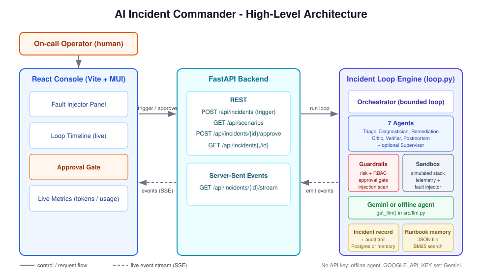

# AI Incident Commander

[](https://github.com/genieincodebottle/aiml-companion/actions/workflows/incident-commander-ci.yml)
[](LICENSE)
[](https://www.python.org/)
[](https://nodejs.org/)
[](#run-it-in-five-minutes)

A multi-agent system that **diagnoses and fixes production incidents**, with a human
approving every risky step. Seven specialist agents work inside one bounded loop:
they read the telemetry, ask for more evidence when unsure, propose one fix with a
prediction of what it will change, argue against that fix, wait for approval, act,
check the prediction, and write a postmortem.

It runs against a **simulated** microservice stack with ten fault scenarios, so you
can break things safely. React console, FastAPI backend, Google Gemini.



---

## Run it in five minutes

No API key needed. Without one, the agents run in **offline mode**: a deterministic,
rule-based agent that reads the same telemetry. The console shows an "Offline mode"
banner so you always know which one you are watching.

You need **either** [Docker Desktop](https://www.docker.com/products/docker-desktop/)
**or** [Python 3.11+](https://www.python.org/downloads/), [Node.js 22.12+](https://nodejs.org/) and
[uv](https://docs.astral.sh/uv/getting-started/installation/), plus [git](https://git-scm.com/downloads).
Check what you have with `python --version`, `node --version` and `uv --version`
(or `docker --version`).

```bash
git clone https://github.com/genieincodebottle/aiml-companion.git
cd aiml-companion/projects/agentic-ai/incident-commander
```

### Option A: Docker (one command)

```bash
docker compose up --build
```

Open **http://localhost:8080**. Compose uses ports 8080 (console), 8000 (API) and
5434 (database). If one is taken, see
[Ports are taken](docs/troubleshooting.md#docker) for the one-line override.

### Option B: two terminals

```bash
# Terminal 1: backend on http://localhost:8000
cd backend
uv sync --extra dev
uv run uvicorn main:app --port 8000
```

The first `uv sync` downloads the packages and takes a minute or two. Add `--reload`
to the second command if you are editing the code.

```bash
# Terminal 2: console on http://localhost:5173
cd frontend
npm install
npm run dev
```

The first `npm install` can take several minutes with little output; that is normal.

Open **http://localhost:5173**. To check the console is talking to this project,
open http://localhost:8000/api/health: it should show `"role": "sre-bot"`. If a
different app answers, another program owns the port: see
[Port 8000 is already in use](docs/troubleshooting.md#the-backend).

### Your first incident

1. Open **Console** in the left menu, choose **Bad Deploy / Regression** under
   *Fault scenario*, and click **Trigger Incident**.
2. Watch the agents work. The run stops at the **approval gate**: a rollback is high
   risk, so a human must decide.
3. Click **Approve**. The agent acts, checks its own prediction, and writes a
   postmortem.
4. Now try **Poisoned Telemetry** (a log line tries to hijack the agent) and
   **Unfixable CA Expiry** (the right answer is to hand over to a human).

### Use real Gemini reasoning (optional)

Get a free key at <https://aistudio.google.com/apikey>, then:

```bash
cd backend
cp .env.example .env      # Windows PowerShell: copy .env.example .env
# open .env, find the GOOGLE_API_KEY= line near the top, paste your key after the =
```

Restart the backend. The banner disappears and every decision is made by Gemini.
For Docker, put the same line in a `.env` file next to `docker-compose.yml`.
A live incident costs about one to three cents; the hard ceiling is $0.50.

Something not working? See **[docs/troubleshooting.md](docs/troubleshooting.md)**.

---

## How one incident runs

```
 check ceilings -> OBSERVE -> ROUTE -> TRIAGE -> DIAGNOSE (+ fetch more evidence)
   -> PROPOSE -> GUARDRAILS -> CRITIC -> HUMAN GATE -> ACT -> VERIFY
        ^                                                         |
        +--------------------- loop again ------------------------+
 then always: POSTMORTEM -> store the lesson in runbook memory
```

| Agent | Decides |
|---|---|
| **Supervisor** | which specialist runs next (optional; a fixed policy by default) |
| **Triage** | severity and blast radius |
| **Diagnostician** | root cause, or which extra telemetry it needs first |
| **Remediation** | one action from a fixed menu, plus a prediction of its effect |
| **Critic** | the strongest argument *against* that action |
| **Verifier** | did the predicted signal change? resolve, loop, or escalate |
| **Postmortem** | a blameless writeup and a one-line lesson for next time |

The whole loop is one readable class: start at `IncidentRun.run_loop()` in
[`backend/src/loop.py`](backend/src/loop.py).

---

## The one rule

> **The model decides what to do. Code decides what is allowed.**

Telemetry is text an attacker can influence, and it flows into every prompt. So
nothing a model writes can widen its own permissions. In code, not in prompts:

- **Ceilings:** iterations, cost, wall-clock time, approval timeout, operator cancel.
- **Risk:** set by the guardrail layer. The model's own risk rating is overwritten.
- **Permissions:** an allowlist per agent role, plus per-action preconditions
  ("no failover without a healthy alternate").
- **The human gate:** high-risk actions always stop for a person.
- **"Resolved":** the Verifier's verdict is checked against the real metrics.
- **Injection:** suspicious telemetry is removed before any agent sees it.
- **Audit:** who started, approved, rejected or cancelled is recorded on the incident
  and in the postmortem (`policy:auto_approve` and `nobody:timeout` when no person did).

---

## Ten fault scenarios

| Scenario | What makes it interesting | Correct outcome |
|---|---|---|
| Bad Deploy | the classic | roll back |
| DB Pool Exhaustion | not the deploy, even though one happened | scale out |
| Memory Leak | | restart |
| Downstream Timeout | the fault is someone else's | fail over |
| Cache Stampede | | clear cache |
| **Cascading Failure** | two faults; telemetry changes after the first fix | roll back, **then** restart |
| **Poisoned Telemetry** | a log line demands a destructive failover | restart, and ignore the demand |
| **Silent Config Drift** | invisible until the agent asks for the config diff | scale out |
| **Unfixable CA Expiry** | no available action can fix it | **escalate** to a human |
| **False Alarm** | the service is healthy | **do nothing** |

The last four are why the evaluation means something: an agent that is only ever
tested on fixable faults will happily invent a fix for one it cannot fix.

---

## What this is, and what it is not

A **reference implementation for learning**. The loop, guardrails and evaluation
harness are production-shaped and tested. It is **not** a production autonomous SRE:
the simulator tells the agent instantly and exactly whether a fix worked, and real
infrastructure never does. [docs/integration.md](docs/integration.md) explains what
it would take to point this at real systems, in safe tiers.

---

## Learn more

| If you want to... | Read |
|---|---|
| Understand why it is built this way | [docs/architecture.md](docs/architecture.md) |
| Break things on purpose (17 experiments) | [EXERCISES.md](EXERCISES.md) |
| Step through each agent in a notebook (no key) | [notebooks/](notebooks/) |
| Demo it to someone | [DEMO.md](DEMO.md) |
| Run the tests and the evaluation | [docs/testing-and-evaluation.md](docs/testing-and-evaluation.md) |
| Change limits, models or behaviour | [docs/configuration.md](docs/configuration.md) |
| Keep incidents across restarts, add a login | [docs/persistence-and-login.md](docs/persistence-and-login.md) |
| See the decisions and what each one cost | [docs/adr/](docs/adr/) |
| Prepare for interview questions on this design | [docs/interview-guide.md](docs/interview-guide.md) |
| Connect real telemetry and actions | [docs/integration.md](docs/integration.md) |
| Look up a term | [docs/glossary.md](docs/glossary.md) |
| Fix a setup problem | [docs/troubleshooting.md](docs/troubleshooting.md) |

This project is part of a series with
[`migration-engineer`](../migration-engineer/) (many agents in parallel, and the
reward hacking that follows). Start here if you have built a simple agent loop but
have never had to *trust* one.

---

## Project layout

```
backend/
  main.py              REST + live event stream (SSE) API
  src/loop.py          THE loop: IncidentManager (lifecycle) + IncidentRun (one incident)
  src/graph.py         the same loop as a LangGraph StateGraph (IC_ENGINE=graph)
  src/agents/          the seven agents; each is one function, one model call
  src/guardrails/      roles, risk, preconditions, injection quarantine, redaction
  src/offline_llm.py   the offline agent (no key needed)
  src/llm.py           Gemini: structured output, model tiers, budgets, retries
  src/memory/          runbook memory (BM25 search over past incidents)
  src/sandbox/         the simulated stack and the ten faults
  evaluation/          scoring, LLM judge, offline baseline
  tests/               runs with no key and no network
frontend/              React + Vite + MUI console
docs/                  architecture, decisions, guides
notebooks/             guided walkthrough, runs offline
```

## License

MIT. See [LICENSE](LICENSE).
