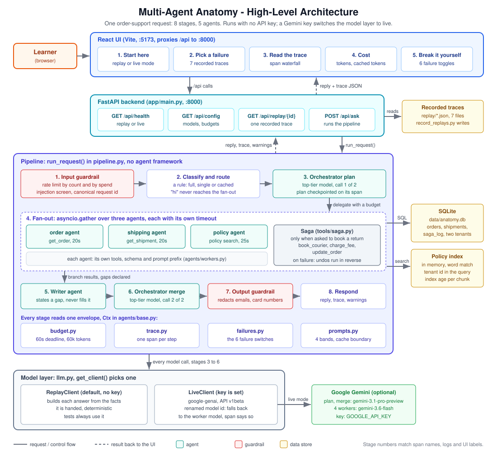

# Multi-Agent Anatomy

[](LICENSE)
[](https://www.python.org/)
[](https://nodejs.org/)
[](#run-it)
[](#no-framework-on-purpose)

An order-support assistant for an online shop, in **8 stages and 5 agents**, built so
you can **break it on purpose and watch what happens**. It answers "where is my order,
and can I still return it?" correctly, and that is the least interesting part. The
hard parts in production are partial failure, budgets that travel with the request,
undoing half-finished changes, per-agent timeouts, prompt caching, and traces that
stay green while the answer is wrong. Each one has a toggle here. The main view is a
**trace waterfall**, not a chat window.

It is the runnable companion to the post
[Inside a Production Multi-Agent GenAI System](https://aimlcompanion.ai/blog/production-multi-agent-genai-architecture-2026).
React UI, FastAPI backend, SQLite, Google Gemini, and no agent framework.



---

## Run it

No API key needed. Without one, every model call goes to the **replay client**: a
deterministic composer that builds each agent's answer from the real tool output it is
handed. It is not a canned reply, so the failure toggles change the answer exactly as
they would with a live model. The UI shows a "no API key" chip so you always know which
mode you are in.

You need [Python 3.12+](https://www.python.org/downloads/),
[uv](https://docs.astral.sh/uv/getting-started/installation/),
[Node.js 22.12+](https://nodejs.org/) and [git](https://git-scm.com/downloads). Check
with `python --version`, `uv --version` and `node --version`. There is no Docker setup
for this project.

```bash
git clone https://github.com/genieincodebottle/aiml-companion.git
cd aiml-companion/projects/agentic-ai/multi-agent-anatomy
```

Then two terminals, both starting from that directory.

```bash
# Terminal 1: backend on http://localhost:8000
cd backend
uv sync --no-install-project --extra dev
uv run --no-sync uvicorn app.main:app --port 8000
```

`uv sync` creates the virtual environment and installs everything in
[pyproject.toml](backend/pyproject.toml), including the test tools. `--no-install-project`
installs the dependencies without packaging the backend itself, because the app runs
straight from `backend/app/`. `--no-sync` tells `uv run` to use that environment as it
is. Add `--reload` to the second command if you are editing the code.

```bash
# Terminal 2: UI on http://localhost:5173
cd frontend
npm install
npm run dev
```

Open **http://localhost:5173**. The UI proxies `/api` to port 8000
([vite.config.js](frontend/vite.config.js)). To check the backend is the one answering,
open http://localhost:8000/api/health: it should show `"mode": "replay"`,
`"stages": 8` and `"agents": 5`.

The frontend pins rollup to its WebAssembly build through an `overrides` entry in
[package.json](frontend/package.json). Rollup normally ships a per-platform native
binary, and [npm skips it often enough](https://github.com/npm/cli/issues/4828) that
`npm run dev` fails with `MODULE_NOT_FOUND` on `rollup/dist/native.js`. The wasm build
has no platform binary, so there is nothing for npm to skip.

### Your first run

1. **Start here** explains the four failures you are about to see. Click
   **Start the tour**.
2. **Pick a failure** lists seven recorded traces. Choose
   **5. Every span green, the answer wrong**.
3. **Read the trace** opens the waterfall. Every span is green. The reply quotes a
   14 day refund window; the current policy says 30.
4. **Tokens** shows total, cached, uncached and output tokens for the question, the
   tokens per model and per stage, and how many input tokens were served from the
   prompt cache. The project keeps no price table and shows no money.
5. **Break it yourself** lets you write a question, switch on any of the six failure
   toggles, and click **Run it and show me the trace**. This runs the real pipeline
   against the seeded database, through the replay client, with no key.

To regenerate the recorded set: `cd backend && uv run --no-sync python record_replays.py`.
It forces replay mode, so a key in `.env` never ends up in a recording.

### Use real Gemini (optional)

Get a free key at <https://aistudio.google.com/apikey>, then from the project root:

```bash
cp .env.example .env      # Windows PowerShell: copy .env.example .env
# open .env and replace your_google_api_key_here on the GOOGLE_API_KEY= line with your key
```

Restart the backend. `/api/health` now reports `"mode": "live"` and the chip in the UI
says "live model". Either `GOOGLE_API_KEY` or `GEMINI_API_KEY` works, and `.env` is
read from the project root and then from `backend/`
([config.py](backend/app/config.py)).

- Leave the placeholder text in place and the backend still sees a key and switches to
  live mode, so your own runs fail at the first model call. Recorded traces still load.
- Set `REPLAY_ONLY=true` in `.env` and restart to go back to replay with the key kept.
- `ORCHESTRATOR_MODEL`, `WORKER_MODEL` and `CLASSIFIER_MODEL` override the model ids.

Live mode changes three things and nothing else:

1. Model calls go to Gemini instead of the replay composer.
2. Token counts come from the provider's own usage metadata where it gives them.
3. If the top-tier model id has been renamed, the call falls back to the worker model
   and the span records a warning.

Checked against a real key on 2026-08-04: no fallbacks, and the stale-passage toggle
behaves as it does in replay. Gemini reads the corrupted passage and reports a 14 day
return window while every span stays green.

---

## How one request runs

One question, "Where is my order ORD-4412 and can I still return it?", through the
eight stages in [pipeline.py](backend/app/pipeline.py). The stage numbers appear in the
span names, the log lines and the UI labels. If you renumber one, renumber all three.

1. **Input guardrail.** [guardrails.py](backend/app/guardrails.py) checks two rate
   limits, requests per minute and tokens per minute (240,000 by default). It screens for obvious prompt
   injection, and it hashes tenant and question into a canonical request id, so a retry
   is flagged as a repeat and not treated as a new request. A budget is set here once:
   60s and 60,000 tokens ([budget.py](backend/app/budget.py)).
2. **Classify and route.** A rule (`_classify` in `pipeline.py`) picks `full`, `single`
   or `cached`. "hi" gets a canned reply and never reaches the fan-out. The span is
   counted as a call to the small classifier model, so the token line shows what a
   model-based router would add.
3. **Orchestrator plan.** [agents/orchestrator.py](backend/app/agents/orchestrator.py)
   calls the top-tier model, the first of exactly two calls per request. The plan is
   written onto its span before anything is delegated, so a request that dies later
   still shows what it meant to do.
4. **Fan-out.** `asyncio.gather` runs the order, shipping and policy agents
   ([agents/workers.py](backend/app/agents/workers.py)) in parallel, each under its own
   timeout (20s, 20s, 25s) inside the 60s deadline. Order and shipping query SQLite
   through [tools/catalog.py](backend/app/tools/catalog.py); each tool gets a budget
   derived from the time its agent has left (8s at most). Policy searches
   [tools/policy_index.py](backend/app/tools/policy_index.py) with the tenant id inside
   the query. If the customer asks to book a return, the saga in
   [tools/saga.py](backend/app/tools/saga.py) runs `book_courier`, `charge_fee`,
   `update_order`, and on a failure runs the undos in reverse.
5. **Writer agent.** Composes the reply from the branches that returned and states any
   branch that did not, instead of filling the gap.
6. **Orchestrator merge.** The second top-tier call. Its prompt starts with the same
   stable prefix as stage 3, so most of it is a cache hit.
7. **Output guardrail.** Redacts email addresses and card-like numbers. What leaves is
   not always what was generated.
8. **Respond.** The API returns the reply, the full trace, a per-model token breakdown
   and any semantic warnings.

Every stage reads one envelope, `Ctx` in [agents/base.py](backend/app/agents/base.py):
the trace, the shared budget, the failure switches, the model client and the tenant.
Every model call goes through [llm.py](backend/app/llm.py), where `get_client()` returns
the replay client or the live one. Every prompt is laid out in four bands in
[prompts.py](backend/app/prompts.py), least changing first, with the cache boundary
marked, because a provider caches a prefix and the first changed byte ends it.

---

## The one rule

> **A green span does not mean a right answer.**

A span in [trace.py](backend/app/trace.py) can finish `ok` and still carry a warning.
The stale-passage toggle is the proof: retrieval succeeds, the citation is real,
latency is normal, every span is green, and the refund window in the answer is wrong.
There is no status code for wrong. Index age is the only signal, and it travels as a
**warning on a green span**, not an error, because the request did succeed. The API
returns `all_spans_green` and `semantic_warnings` side by side so the UI can say so.

### No framework, on purpose

No LangGraph, no CrewAI, no agent SDK. The post argues that frameworks hide both the
token use and the failure modes, and those are the two things this project is for. The
fan-out is `asyncio.gather` over three functions, a delegation is an argument, and the
orchestrator loop is a loop. If the plumbing looks small, that is the argument: the hard
parts of a multi-agent system are not the loop.

### Where each idea lives

| The post says | The code | Where |
|---|---|---|
| Decide a deadline and token budget at the edge and carry it down | `RequestBudget` / `Delegation`, a view not a copy, so three parallel agents draw down one pool | [budget.py](backend/app/budget.py) |
| Pass the remaining deadline into every delegation | Spans record `deadline_remaining_s` and `tokens_remaining` at entry | [trace.py](backend/app/trace.py) |
| Give each tool a budget derived from the time left | `Delegation.tool_timeout()` | [budget.py](backend/app/budget.py) |
| Order prompts least changing to most changing | Four bands, cache boundary marked in the source | [prompts.py](backend/app/prompts.py) |
| Put the tenant id inside the search query | `search()` scopes candidates before it ranks and takes no argument that widens it | [tools/policy_index.py](backend/app/tools/policy_index.py) |
| Pair every step with its own undo | `Step` cannot be built without a compensator | [tools/saga.py](backend/app/tools/saga.py) |
| Validate at every boundary, carry provenance | A schema per agent, `confidence` and `source` in every handoff | [prompts.py](backend/app/prompts.py), [agents/base.py](backend/app/agents/base.py) |
| Compress on the way out | `compress_for_return`; the full output stays on the span | [agents/base.py](backend/app/agents/base.py) |
| Index age is the metric nobody has on a dashboard | `index_age_days` per chunk, warning above 90 days | [tools/policy_index.py](backend/app/tools/policy_index.py) |
| Hard caps on depth and iterations | `max_delegation_depth`, `max_orchestrator_iterations` | [config.py](backend/app/config.py) |
| Limit by tokens, not only by count | Two limiters, requests per minute and tokens per minute | [guardrails.py](backend/app/guardrails.py) |
| Canonical request ids stop retry storms | `canonical_request_id`; the trace says when a request is a repeat | [guardrails.py](backend/app/guardrails.py) |

---

## The seven recorded traces

Each trace is the same pipeline with one failure toggle on, recorded by
[record_replays.py](backend/record_replays.py) into [backend/replay/](backend/replay/).
The numbers are read from those files.

| Trace | Toggle | What you watch | Spans green |
|---|---|---|---|
| 1. The happy path | none | Read the waterfall once so the broken ones are legible. 7 model spans, 3,715 tokens | 22 of 22 |
| 2. Shipping agent killed | Kill the shipping agent | One red branch, two green. Stage 5 declares the gap. The reply still goes out and has no invented tracking number | 18 of 20 |
| 3. Slow tool | Add 12s latency to `get_shipment` | The tool is cut at its 8s budget, inside the agent's 20s and the request's 60s. The agent survives to report the gap | 18 of 21 |
| 4. Saga rollback | Fail step 3 of the booking saga | `book_courier`, `charge_fee`, `update_order` fails, then `undo:charge_fee` and `undo:book_courier` | 26 of 28 |
| **5. Green and wrong** | **Serve a stale policy passage** | **Nothing turns red.** The answer says 14 days instead of 30. 2 semantic warnings | **22 of 22** |
| 6. Cache off | Turn prompt caching off | Cached tokens fall from 1,854 to 0 for the same 3,715 tokens | 22 of 22 |
| 7. Cross-tenant attempt | Attempt a cross-tenant retrieval | Zero passages from the other retailer. Nothing was fetched and then dropped | 22 of 22 |

Each scenario is run twice and the second run is recorded. A cache is empty until
something fills it, so recording the cold run would overstate every scenario's token
count and hide what the caching toggle shows. The database is reseeded between
scenarios, so the saga's writes do not leak into the next recording.

### Tests

```bash
cd backend  && uv run --no-sync pytest -q   # 27 tests, all six toggles asserted
cd frontend && npm run smoke                 # renders every page against every recorded trace
```

The tests force replay mode even when a key is present
([tests/conftest.py](backend/tests/conftest.py)), so they are deterministic and make no
model calls. The two that carry the project:

- `test_corrupt_passage_leaves_every_span_green_and_the_answer_wrong`
- `test_no_cross_tenant_passage_is_ever_retrieved`

The second is parameterized over queries that ask for the other tenant's data by name,
including the exact text of its private note. Another test fails if anyone adds a
parameter to `search()` that would let a caller widen the scope.

---

## Reading it alongside the post

The post has five sections and mentions stages 1 to 6 in passing. **This project's 1 to
8 is its own numbering**, not a quote: the two guardrails get their own stages so they
get their own spans, and the final response is split out from the merge. Two places
where the numbers do not line up:

- the post's informal stage 2 is semantic caching; here stage 2 is classify and route,
  which is where a cache lookup would sit
- the post stops at 6, where the orchestrator decides the work is done; this project
  continues into the output guardrail and the response

| Post section | Stages | Where it lives in the code |
|---|---|---|
| The edge | 1, 2 | [guardrails.py](backend/app/guardrails.py), stage 2 in [pipeline.py](backend/app/pipeline.py) |
| The orchestrator | 3, 4, 6 | [agents/orchestrator.py](backend/app/agents/orchestrator.py), fan-out in [pipeline.py](backend/app/pipeline.py) |
| Why more than one agent at all | 4 | [agents/workers.py](backend/app/agents/workers.py), one prompt prefix and one toolset per agent |
| The half of retrieval that nobody draws | 4 | [tools/policy_index.py](backend/app/tools/policy_index.py), chunking, tenant scoping, index age |
| The handoff is the contract | 4, 5 | Per-agent schemas in [prompts.py](backend/app/prompts.py), validation in [agents/base.py](backend/app/agents/base.py) |
| Tools and the outside world | 4 | [tools/catalog.py](backend/app/tools/catalog.py) and [tools/saga.py](backend/app/tools/saga.py) |
| The framework sections | all | [No framework, on purpose](#no-framework-on-purpose) above |

The post's central claim, that a well-formed answer can pass every check and still be
wrong, is not one section. It runs through all of them. Here it is one toggle: **Serve a
stale policy passage**.

---

## What this is, and what it is not

A **reference implementation for learning** how a multi-agent request fails. It is not
an order-support product. What is simulated, and where the limits are:

- **The data is seeded.** SQLite holds two fake retailers' customers, orders and
  shipments ([tools/db.py](backend/app/tools/db.py)), created on first start. The
  courier and payment systems in the saga are in-memory stand-ins; only `update_order`
  writes to the database.
- **Retrieval is word matching**, not a vector database. It is enough to show every
  retrieval failure the post names, and it needs no service and no embedding key.
- **Stage 2 is a rule**, counted as if it were a small model call.
- **Replay token counts are estimates**, about 4 characters per token, and the prompt
  cache is simulated. Real providers only cache a prefix above roughly 1,024 to 2,048
  tokens; the prompts here are shorter, so `CACHE.min_prefix_tokens` is lowered to 200
  to keep the mechanism visible. Read it as this demo's threshold, not the provider's.
- **The Tokens page counts, it does not price.** [config.py](backend/app/config.py)
  holds model ids and budgets only. Model ids go stale; change them there and the page,
  the trace and the tests follow.
- **The tokens-per-minute default** (240,000) was derived from the earlier spend limit
  and the seven recorded traces. It is a demo number; set it from your own traffic.
- **The injection screen catches obvious patterns only**, and says so in its own output.
  The rate limiter and the request-id memory live in one process and reset on restart.
- **No login and no multi-user state.** CORS allows only the local UI.
- **Out of scope, on purpose:** security beyond tenant scoping and output redaction, the
  governance section of the post, and its interview questions. They do not get clearer
  by being runnable.

---

## Learn more

| If you want to... | Read |
|---|---|
| The ideas behind every stage | [Inside a Production Multi-Agent GenAI System](https://aimlcompanion.ai/blog/production-multi-agent-genai-architecture-2026) |
| Follow one request in code | [backend/app/pipeline.py](backend/app/pipeline.py), top to bottom |
| See every failure toggle and what it teaches | [backend/app/failures.py](backend/app/failures.py) |
| Change models, budgets or timeouts | [backend/app/config.py](backend/app/config.py) |
| Compare with the other agent projects | [The agentic-ai folder index](../README.md) |

The other agent projects here each add a topology or a framework. This one studies
failure. The closest neighbours:

| Project | Its argument |
|---|---|
| [multi-agents-app-on-aws](../multi-agents-app-on-aws/) | Deploy a supervisor and three specialists on Bedrock AgentCore |
| [ai-agents-project](../ai-agents-project/) | Quality-gated routing and iterative refinement with LangGraph |
| [due-diligence-agent](../due-diligence-agent/) | Fact-checking and contradiction resolution across parallel agents |
| [smart-claims-processor](../smart-claims-processor/) | Human-in-the-loop pause and resume with durable checkpointing |
| **multi-agent-anatomy** | **How it fails.** One request, eight stages, broken on demand |

`smart-claims-processor` also has token limits and a per-agent trace panel; there the
trace explains a decision that went well, and the pipeline is built on LangGraph. Here
the trace is the main view and the interesting runs are the broken ones.
`multi-agents-app-on-aws` uses the same supervisor-plus-specialists shape with four
agents to this project's five, so the two diagrams can be read against each other.

---

## Project layout

```
backend/
  app/main.py            FastAPI: health, config, ask, recorded traces
  app/pipeline.py        the eight stages, in order, in one function
  app/agents/            orchestrator (stages 3 and 6), four workers, shared plumbing
  app/tools/             SQL tools, tenant-scoped policy index, saga, seeded SQLite
  app/guardrails.py      stages 1 and 7: rate limits, injection screen, redaction
  app/llm.py             ReplayClient (no key) and LiveClient (Gemini)
  app/budget.py          the request budget every stage draws down
  app/trace.py           spans, warnings, token totals
  app/failures.py        the six failure toggles
  app/prompts.py         prompts in four bands, cache boundary marked
  app/config.py          model ids, budgets, timeouts: the one file that goes stale
  replay/                the seven recorded traces
  record_replays.py      regenerates replay/ with no key
  tests/                 27 tests, replay mode forced
  data/                  anatomy.db, created on first start (git-ignored)
frontend/                React + Vite UI: five pages, trace waterfall
docs/                    high-level architecture diagram
.env.example             live-mode settings; replay mode needs none of it
```

## License

MIT. See [LICENSE](LICENSE).
