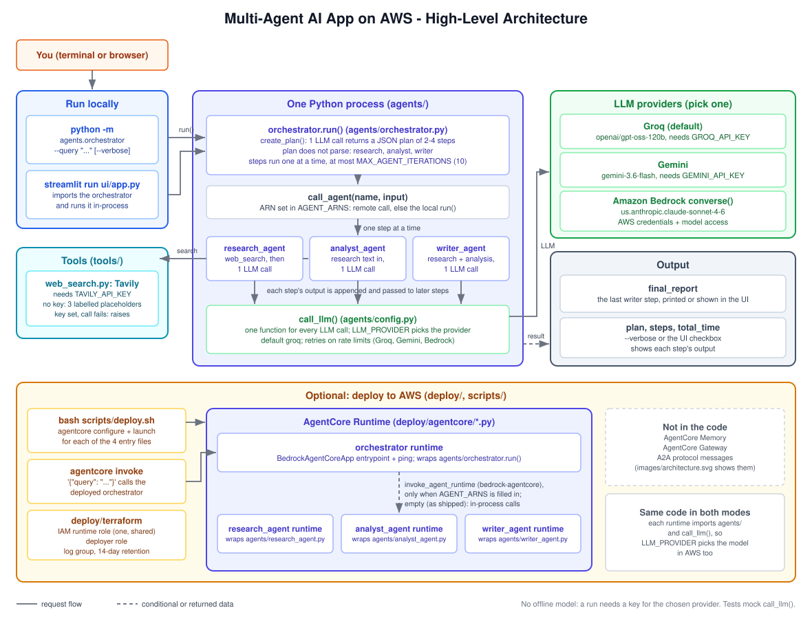

# Multi-Agent AI App on AWS

[](LICENSE)
[](https://www.python.org/)

A research team of four agents written in plain Python, with **no agent framework**. An
orchestrator asks the model for a plan, then calls a research agent, an analyst agent and
a writer agent **one at a time**, passing each agent's output forward as text. Every LLM
call goes through one function, `call_llm()` in `agents/config.py`, so switching between
Groq, Gemini and Amazon Bedrock is one environment variable.

It runs on your laptop as one Python process, and the same agent code can be deployed to
Amazon Bedrock AgentCore Runtime. Python, boto3, Streamlit; Groq by default.

> Also published as a standalone repo:
> [github.com/genieincodebottle/multi-agents-app-on-aws](https://github.com/genieincodebottle/multi-agents-app-on-aws).



---

## Run it

There is no offline model: a run needs a key for one LLM provider. Groq is the default.
Web search is optional: without a Tavily key the research agent gets three labelled
placeholder results, and its output says so.

You need [Python 3.12+](https://www.python.org/downloads/),
[uv](https://docs.astral.sh/uv/getting-started/installation/) (or plain `pip`) and
[git](https://git-scm.com/downloads). Check with `python --version` and `uv --version`.

```bash
git clone https://github.com/genieincodebottle/aiml-companion.git
cd aiml-companion/projects/agentic-ai/multi-agents-app-on-aws

uv venv
source .venv/bin/activate          # Windows PowerShell: .venv\Scripts\Activate.ps1
uv pip install -r requirements.txt # python-dotenv
uv pip install groq                # the default provider's client

cp .env.example .env               # Windows: copy .env.example .env
```

Get a Groq key at <https://console.groq.com/keys>, open `.env`, and set:

```
LLM_PROVIDER=groq
GROQ_API_KEY=gsk_paste_your_key_here
```

Then run one request:

```bash
python -m agents.orchestrator --query "What is machine learning?"
python -m agents.orchestrator --query "Compare Python vs Rust for AI" --verbose
```

Without `--query` it researches a default question about agent frameworks. If `python`
is not found on macOS or Linux, use `python3`.

The web app runs the same orchestrator in-process:

```bash
uv pip install -r ui/requirements.txt
streamlit run ui/app.py
```

Each agent also runs on its own: `python -m agents.research_agent "your topic"`,
`python -m agents.analyst_agent` and `python -m agents.writer_agent` (the last two use
built-in sample input). `bash scripts/test_agents.sh` runs the research agent, the analyst
and the full orchestrator with your key, then tries `agentcore invoke` if the AgentCore CLI
is installed.

### Your first research run

1. Run `python -m agents.orchestrator --query "What is machine learning?"`.
2. The log shows the provider first (`LLM Provider: groq | Model: openai/gpt-oss-120b`),
   then `Orchestrator: creating execution plan...` and `plan has N steps`.
3. Each step logs `Orchestrator: step 1/N - calling research agent` and so on. With no
   Tavily key you also see a warning that search is returning placeholder results, and
   `Research Agent: completed with 3 sources (search_mode=placeholder)`.
4. The **FINAL REPORT** block is the last writer step's output. With placeholder search,
   the research step's text starts with a NOTE that the findings are not researched and
   the citations are not real.
5. The last line gives the run time and the number of steps. Add `--verbose` to see the
   plan and the first 500 characters of every step.

In the app: type a question (or click an example in the sidebar), click **Research**, and
tick **Show step-by-step details** to see the plan and each agent's output.

### Use real web search (optional)

Get a Tavily key at <https://tavily.com> and set `TAVILY_API_KEY=` in `.env`. The research
agent then gets up to `MAX_RESEARCH_RESULTS` (5) real results per search. If the key is
set but the search fails, the research step reports that and makes no LLM call, rather
than writing from placeholders.

### Switch the LLM provider (optional)

| Provider | Install | Set in `.env` | Default model |
|---|---|---|---|
| Groq (default) | `uv pip install groq` | `LLM_PROVIDER=groq`, `GROQ_API_KEY` | `openai/gpt-oss-120b` |
| Gemini | `uv pip install google-genai` | `LLM_PROVIDER=gemini`, `GEMINI_API_KEY` ([key](https://aistudio.google.com/apikey)) | `gemini-3.6-flash` |
| Amazon Bedrock | `uv pip install boto3` | `LLM_PROVIDER=bedrock`, AWS credentials | `us.anthropic.claude-sonnet-4-6` |

Override the model with `GROQ_MODEL_ID`, `GEMINI_MODEL_ID` or `BEDROCK_MODEL_ID`. Other
IDs named in `.env.example`: Groq `llama-3.3-70b-versatile`, `llama-3.1-8b-instant`,
`qwen/qwen3-32b`; Gemini `gemini-3.5-flash-lite`, `gemini-3.1-pro-preview`; Bedrock
`us.amazon.nova-2-lite-v1:0`, `us.anthropic.claude-haiku-4-5-20251001-v1:0`. Bedrock
needs model access enabled in your account and region; see
[AWS setup](#aws-setup-only-for-bedrock-or-deploying).

---

## How one research request runs

1. **Entry.** `python -m agents.orchestrator` (`main()` in
   [`agents/orchestrator.py`](agents/orchestrator.py)) and
   [`ui/app.py`](ui/app.py) both call `orchestrator.run(query)`.
2. **Config.** Importing [`agents/config.py`](agents/config.py) loads `.env` from the
   project root, reads `LLM_PROVIDER` (default `groq`) and the model ID, and logs both.
3. **Plan.** `create_plan()` makes one `call_llm()` call with `PLANNING_PROMPT` at
   temperature 0.1. The prompt asks for JSON with 2 to 4 steps, each naming an agent
   (`research`, `analyst` or `writer`), a task, and whether it needs earlier output.
   Markdown fences are stripped. If the reply is not valid JSON, the plan falls back to
   research, then analyst, then writer. A longer plan is cut to `MAX_AGENT_ITERATIONS`
   (10).
4. **Steps, one at a time.** For each step the orchestrator builds `{"query": task}` and
   adds context when the step asks for it: the analyst gets all research so far, the
   writer gets research and analysis, a second research step gets earlier research as
   `context`. `call_agent()` calls the agent module's `run()` in-process, or the deployed
   runtime if its ARN is set in `AGENT_ARNS`.
5. **research_agent** ([`agents/research_agent.py`](agents/research_agent.py)). Calls
   `web_search()` ([`tools/web_search.py`](tools/web_search.py)), plus a second search
   with the context when there is one, then one `call_llm()` at temperature 0.2 to
   summarise with `[Source N]` citations. Every result carries `provenance` (`tavily` or
   `mock`), and the step returns a `search_mode` of `live`, `placeholder` or
   `unavailable`.
6. **analyst_agent** ([`agents/analyst_agent.py`](agents/analyst_agent.py)). One call at
   temperature 0.3: comparisons, patterns, tables. With no research it returns an error
   text instead.
7. **writer_agent** ([`agents/writer_agent.py`](agents/writer_agent.py)). One call at
   temperature 0.4, up to 4,096 output tokens: the final report.
8. **Result.** `run()` returns the query, the plan, every step's output, `final_report`
   (the last writer step, or the last step if there was no writer) and `total_time`.

That is one planning call plus one call per step: 4 LLM calls for the usual three-step
plan. `call_llm()` retries a rate-limited call twice, after 1 s and then 2 s, for all
three providers, and turns Bedrock's access, billing and model-ID errors into readable
messages.

---

## The one rule

> **No framework. Every mechanism is a plain Python function you can read.**

Frameworks hide the core patterns behind their own API. Here each pattern is visible:

| Pattern | How it is built |
|---|---|
| Orchestration | `run()`: ask for a plan, then a `for` loop over the steps |
| Agent communication | Python dicts between functions (local), or `invoke_agent_runtime` (deployed) |
| Context passing | Strings accumulated per agent type and passed to later steps |
| LLM calls | `call_llm()` calls the Groq, Gemini or Bedrock SDK directly |
| Tools | `web_search()` is a plain function the research agent calls |

`agents/` is about 1,100 lines including comments and error messages. Once these
mechanics are familiar, a framework such as LangGraph or CrewAI is easier to read,
because you know what it does underneath.

The search tool follows the same spirit: **a placeholder never passes as a source.** With
no key, results are tagged `provenance="mock"` and the prompt text warns the model. With a
key that fails, `SearchUnavailable` is raised instead of quietly returning placeholders,
which used to produce confident reports citing `example.com`.

---

## Deploy to AWS (optional)

Needs an AWS account with Bedrock model access ([AWS setup](#aws-setup-only-for-bedrock-or-deploying)).
The deploy and Terraform steps below were read from the scripts, not run for this README.

```bash
uv pip install -r requirements-dev.txt    # pytest, ruff, bedrock-agentcore, the starter toolkit
bash scripts/deploy.sh
```

> **Toolkit status.** These scripts use the Python starter toolkit
> (`bedrock-agentcore-starter-toolkit` 0.3.x). Its README now says the Starter Toolkit CLI
> is no longer supported and points to the AgentCore CLI
> ([aws/agentcore-cli](https://github.com/aws/agentcore-cli), `npm install -g @aws/agentcore`,
> commands `agentcore create`, `dev`, `build`, `deploy`, `invoke`). The toolkit still works for
> existing Python workflows; moving these scripts to the new CLI is a planned change.

`deploy.sh` installs `bedrock-agentcore-starter-toolkit` if the `agentcore` CLI is
missing, then in `deploy/agentcore/` runs `agentcore configure -e <file>.py` and
`agentcore launch` for `research_agent`, `analyst_agent`, `writer_agent` and
`orchestrator`. Each file wraps the matching `agents/*.py` `run()` in a
`BedrockAgentCoreApp` with an entrypoint and a ping. Test the deployed orchestrator with:

```bash
agentcore invoke '{"query": "Compare AI agent frameworks"}'
```

**How the deployed agents talk.** `AGENT_ARNS` in `agents/orchestrator.py` ships empty, so
the deployed orchestrator runs the three specialists in-process inside its own runtime.
To make it call the specialist runtimes, put their ARNs into `AGENT_ARNS` before you
launch the orchestrator. It then calls `invoke_agent_runtime` on the boto3
`bedrock-agentcore` client, with a new UUID session ID per call. The deployed agents run
the same `call_llm()`, so `LLM_PROVIDER` and the provider's key or IAM access must be set
in the runtime environment.

**Terraform** (`deploy/terraform/`) creates the IAM side:

```bash
cd deploy/terraform
terraform init
terraform plan -var="aws_region=us-east-1"
terraform apply -var="aws_region=us-east-1"
terraform output
```

It makes one IAM role for the AgentCore runtimes, shared by all four (Bedrock
`InvokeModel`, AgentCore invoke and sessions, CloudWatch logs), a deployer role, and the
log group `/agentcore/multi-agents/dev` with 14-day retention. `deploy.sh` passes this
role to `agentcore configure --execution-role`: it reads `AGENTCORE_ROLE_ARN` if set,
otherwise the Terraform output `agentcore_runtime_role_arn`, and if neither exists the
toolkit creates its own role. Run `terraform apply` before `deploy.sh` to use the shared role.
Terraform stores no Tavily key: set `TAVILY_API_KEY` in the runtime environment instead.

**Cleanup:**

```bash
bash scripts/cleanup.sh --dry-run    # list the runtimes it would delete
bash scripts/cleanup.sh              # asks, then deletes them
```

It lists runtimes with `aws bedrock-agentcore-control list-agent-runtimes` and deletes the
ones named `research_agent`, `analyst_agent`, `writer_agent` and `orchestrator` (override
with `AGENT_RUNTIME_NAMES="..."` if you passed `--name` to `agentcore configure`). If
`deploy/terraform/terraform.tfstate` exists, it also runs `terraform destroy`. Without the
script: `cd deploy/terraform && terraform destroy -var="aws_region=us-east-1"`.

---

## Tests

26 tests, no API key, no network: every LLM and search call is mocked.

```bash
uv pip install -r requirements-dev.txt   # or just: uv pip install pytest
pytest -q
```

| File | Tests | Checks |
|---|---|---|
| `test_search_provenance.py` | 9 | A failed search raises; placeholders are tagged and warned about; provenance reaches the source list |
| `test_orchestrator.py` | 8 | Plan parsing (plain, fenced, invalid JSON fallback, steps without `agent` skipped), all steps run, context passes forward, unknown agent |
| `test_research_agent.py` | 5 | Empty query, a normal run, a run with context |
| `test_analyst_agent.py` | 4 | No research, a normal run, focus areas |

---

## What this is, and what it is not

A **reference implementation for learning** how orchestration, context passing and
provider switching work without a framework, and how to put the same code on AgentCore.
It is not a production research service. Limits found in the code:

- **No memory.** Nothing persists between runs. There is no AgentCore Memory or
  AgentCore Gateway code; Memory is planned, not in the code yet. The older diagram in `images/architecture.svg` shows both.
- **No A2A protocol.** Deployed agents are called with `invoke_agent_runtime` and a JSON
  payload, and only when `AGENT_ARNS` is filled in.
- **Sequential only.** Steps run one at a time; nothing runs in parallel.
- **One shared IAM role** for all four runtimes in the Terraform, not one role per agent.
- **The plan is only lightly checked.** A step without a non-empty `agent` and `task` is
  skipped with a warning, and if no step is usable the default research, analyst, writer
  plan runs. A valid step that names an unknown agent gives an error string for that
  step.
- **Deploy packaging is unverified here.** `deploy/agentcore/*.py` import `agents/` and
  `tools/` from the project root; check that your `agentcore configure` source path
  includes them.

---

## AWS setup (only for Bedrock or deploying)

<details>
<summary>Install the AWS CLI, create credentials, enable Bedrock models</summary>

1. **Install AWS CLI v2** and check with `aws --version`.
   Windows: [AWSCLIV2.msi](https://awscli.amazonaws.com/AWSCLIV2.msi).
   macOS: [AWSCLIV2.pkg](https://awscli.amazonaws.com/AWSCLIV2.pkg). Linux:

   ```bash
   curl "https://awscli.amazonaws.com/awscli-exe-linux-x86_64.zip" -o "awscliv2.zip"
   unzip awscliv2.zip
   sudo ./aws/install
   ```

2. **Create an IAM user with access keys.** In the AWS Console open IAM, then Users,
   then Create user. Attach `AmazonBedrockFullAccess`, and `IAMFullAccess` only if you
   will deploy to AgentCore. On the user's Security credentials tab, create an access
   key for the CLI and save both values; the secret is shown once.
3. **Configure the CLI** with `aws configure` (region `us-east-1`, output `json`), then
   check with `aws sts get-caller-identity`. If it fails, look for trailing spaces in the
   keys.
4. **Enable Bedrock models.** In [Bedrock model access](https://us-east-1.console.aws.amazon.com/bedrock/home?region=us-east-1#/modelaccess)
   (region us-east-1), request access to the Anthropic model you will use and wait for
   "Access granted".
5. **Point the app at Bedrock** in `.env`:

   ```
   LLM_PROVIDER=bedrock
   BEDROCK_MODEL_ID=us.anthropic.claude-sonnet-4-6
   ```

`bash scripts/setup.sh` checks Python, uv, the AWS CLI and your credentials, creates the
virtual environment, installs `requirements.txt`, copies `.env.example` and checks access
to the default Bedrock model.

</details>

---

## Configuration

| Variable | Default | Description |
|---|---|---|
| `LLM_PROVIDER` | `groq` | `groq`, `gemini` or `bedrock` |
| `GROQ_API_KEY` | | Groq key ([console.groq.com/keys](https://console.groq.com/keys)) |
| `GROQ_MODEL_ID` | `openai/gpt-oss-120b` | Groq model |
| `GEMINI_API_KEY` | | Gemini key ([aistudio.google.com/apikey](https://aistudio.google.com/apikey)) |
| `GEMINI_MODEL_ID` | `gemini-3.6-flash` | Gemini model |
| `AWS_REGION` | `us-east-1` | Bedrock and AgentCore region |
| `BEDROCK_MODEL_ID` | `us.anthropic.claude-sonnet-4-6` | Bedrock model |
| `TAVILY_API_KEY` | (empty) | Web search; empty means labelled placeholders |
| `LOG_LEVEL` | `INFO` | `DEBUG`, `INFO`, `WARNING`, `ERROR` |
| `MAX_RESEARCH_RESULTS` | `5` | Results per Tavily search |
| `MAX_AGENT_ITERATIONS` | `10` | Most plan steps the orchestrator will run |

### Adding an agent

1. Create `agents/my_custom_agent.py` with a `run(input_data: dict) -> dict` that calls
   `call_llm(SYSTEM_PROMPT, input_data["query"])` and returns
   `{"result": ..., "agent": "my_custom"}`.
2. Import it in `agents/orchestrator.py` and add it to `AGENTS`.
3. Describe it in `PLANNING_PROMPT` so the planner can choose it, and decide in `run()`
   which earlier output it should receive.

---

## Troubleshooting

| Problem | Fix |
|---|---|
| `GROQ_API_KEY NOT SET` or `GEMINI_API_KEY NOT SET` | Put the key in `.env` in the project root |
| `GROQ PACKAGE NOT INSTALLED` | `uv pip install groq` |
| `GOOGLE-GENAI PACKAGE NOT INSTALLED` | `uv pip install google-genai` |
| `No module named 'boto3'` with `LLM_PROVIDER=bedrock` | `uv pip install boto3` |
| `MODEL ACCESS DENIED` (Bedrock) | Enable the model in [Bedrock model access](https://console.aws.amazon.com/bedrock/home#/modelaccess), or pick another `BEDROCK_MODEL_ID` |
| `AWS BILLING ISSUE` | The account needs a valid payment method in the billing console |
| `INVALID MODEL ID` | The model is not offered in `AWS_REGION`; pick another ID |
| `NoCredentialsError` | Run `aws configure`, or set `AWS_ACCESS_KEY_ID` and `AWS_SECRET_ACCESS_KEY` |
| Rate-limit errors | `call_llm()` retries twice; wait and run again |
| Report cites `example.com` | No Tavily key: those are the labelled placeholders. Set `TAVILY_API_KEY` |
| `Research could not be completed` | The Tavily key is set but the search failed; check the key and network |
| `python: command not found` | Use `python3` (macOS, Linux), or reinstall Python with "Add to PATH" |
| `.ps1 cannot be loaded` (PowerShell) | `Set-ExecutionPolicy -Scope CurrentUser RemoteSigned`, then activate again |
| No `(.venv)` in the prompt | Activate it: `.venv\Scripts\Activate.ps1` (Windows) or `source .venv/bin/activate` |

---

## Learn more

| If you want to... | Read |
|---|---|
| Read an example report | [examples/sample_research_report.md](examples/sample_research_report.md) |
| Read the AgentCore developer guide | [AWS Bedrock AgentCore docs](https://docs.aws.amazon.com/bedrock-agentcore/latest/devguide/) |
| Read the AgentCore SDK | [bedrock-agentcore-sdk-python](https://github.com/aws/bedrock-agentcore-sdk-python) |
| Browse AgentCore samples | [amazon-bedrock-agentcore-samples](https://github.com/awslabs/amazon-bedrock-agentcore-samples) |
| Learn the agent patterns visually | [AI-ML Companion](https://aimlcompanion.ai/) |

---

## Project layout

```
agents/
  orchestrator.py        plan, run steps one at a time, AGENT_ARNS for deployed calls
  config.py              .env loading, LLM_PROVIDER, call_llm() for Groq / Gemini / Bedrock
  research_agent.py      web_search, then 1 LLM call with [Source N] citations
  analyst_agent.py       1 LLM call: comparisons and patterns
  writer_agent.py        1 LLM call: the final report
tools/
  web_search.py          Tavily search with provenance; labelled placeholders without a key
ui/app.py                Streamlit app; runs the orchestrator in-process
deploy/agentcore/        AgentCore Runtime entry files, one per agent
deploy/terraform/        IAM roles, CloudWatch log group
scripts/                 setup, deploy, cleanup (with --dry-run), test_agents
tests/                   26 tests, no key, no network
examples/                a sample report
images/                  older architecture image
docs/                    this diagram
```

## License

MIT. See [LICENSE](LICENSE).

Built by [Rajesh Srivastava](https://github.com/genieincodebottle) for
[AI/ML Companion](https://aimlcompanion.ai/).
