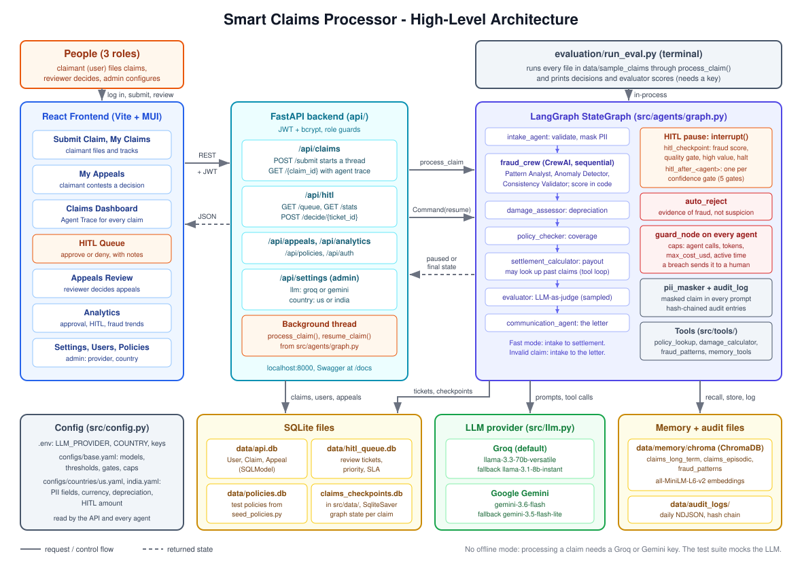

# Smart Claims Processor

[](LICENSE)
[](https://www.python.org/)
[](https://nodejs.org/)

A multi-agent system that **processes insurance claims and pauses for a human reviewer
when fraud risk, claim value or an agent's own confidence calls for it**. A LangGraph
pipeline runs intake, a three-agent CrewAI fraud crew, damage assessment, a policy
check, settlement, an LLM-as-judge evaluator and a letter to the claimant. A paused
claim is checkpointed to SQLite, so the reviewer's decision resumes it from the same
step, even after a restart.

It runs against seeded test policies and sample claims for two country profiles, US
and India. React console, FastAPI backend, Groq or Google Gemini.



---

## Run it

There is no offline mode: processing a claim needs a free
[Groq key](https://console.groq.com/keys) (the default) or a
[Gemini key](https://aistudio.google.com/app/apikey). The test suite needs no key.

You need [Python 3.12+](https://www.python.org/downloads/),
[Node.js 22.12+](https://nodejs.org/), [uv](https://docs.astral.sh/uv/getting-started/installation/)
(`pip install uv` works) and [git](https://git-scm.com/downloads). The first backend
start downloads the `all-MiniLM-L6-v2` embedding model (about 80 MB), so it needs
internet access once.

```bash
git clone https://github.com/genieincodebottle/aiml-companion.git
cd aiml-companion/projects/agentic-ai/smart-claims-processor
```

### Terminal 1: backend on http://localhost:8000

```bash
uv venv
source .venv/bin/activate              # Windows: .venv\Scripts\activate
uv pip install -r requirements.txt     # pulls PyTorch for sentence-transformers

cp .env.example .env                   # Windows: copy .env.example .env
# open .env and paste your key after GROQ_API_KEY=
# (or set LLM_PROVIDER=gemini and add GOOGLE_API_KEY=your_key)

python scripts/generate_secret_key.py  # writes a real API_SECRET_KEY into .env
python scripts/seed_policies.py        # US + India test policies with valid dates
uvicorn api.main:app --port 8000
```

The default country is India (amounts in rupees, IRDAI rules). Set `COUNTRY=us` in
`.env` for US mode. Open http://localhost:8000/docs to check the API is up.

### Terminal 2: console on http://localhost:3000

```bash
cd frontend
npm install
npm run dev
```

Open **http://localhost:3000**. Vite proxies `/api` to port 8000, so start the backend
first. The backend seeds four dev accounts on its first start:

| Username | Password | Role | Use it for |
|---|---|---|---|
| `admin` | `admin123` | `admin` | Users, policies, LLM provider, country |
| `reviewer1` | `review123` | `reviewer` | Deciding HITL tickets |
| `reviewer2` | `review123` | `reviewer` | A second approver |
| `claimant` | `claim123` | `user` | Filing and tracking claims |

These are dev-only credentials, defined in `SEED_USERS` in
[`api/security.py`](api/security.py). Change or delete them before any non-local use.

### Your first claim

1. Log in as `claimant` / `claim123` and open **Submit Claim**.
2. Copy the field values from the `path_b_hitl_high_fraud` entry in
   [`data/sample_claims/test_all_paths_india.json`](data/sample_claims/test_all_paths_india.json)
   (use `test_all_paths_us.json` in US mode) and click **Submit Claim**.
3. Watch the backend terminal. Each agent logs as it runs. When the fraud score
   crosses the review threshold you see
   `Pausing pipeline for manual approval (ticket=HITL-...)` and the claim status
   becomes `pending_human_review`.
4. Log out, log in as `reviewer1` / `review123` and open **HITL Queue**. Click
   **Review** on the ticket to see the triggers, the review brief and each agent's
   output.
5. Pick a decision (**Approve Claim**, **Partial Approval**, **Deny Claim**,
   **Flag for Fraud Investigation** or **Request Documents**), write the required
   review notes and click **Submit Decision**. The pipeline resumes from its
   checkpoint and the claim reaches a final status.
6. Open the claim on **Claims Dashboard** and expand **Agent Trace** to see every
   agent's confidence, reasoning, flags and findings.

Try the other entries in the same file for the other paths (see
[Five paths through the pipeline](#five-paths-through-the-pipeline)).

**Durability check:** stop `uvicorn` while a claim is `pending_human_review`, start
it again, and decide the ticket. The pipeline resumes from the saved checkpoint.

### Use Gemini instead of Groq (optional)

At startup, set both lines in `.env` and restart the backend:

```
LLM_PROVIDER=gemini
GOOGLE_API_KEY=your_key
```

At runtime, log in as `admin` and use the **Settings** page, or call the API. The
switch lasts until the backend restarts.

```bash
curl -X PUT http://localhost:8000/api/settings/llm \
  -H "Authorization: Bearer $TOKEN" \
  -H "Content-Type: application/json" \
  -d '{"provider":"gemini"}'
```

`PUT /api/settings/country` with `{"country":"us"}` switches the country the same way.

| Provider | Primary model | Fallback model | Judge model |
|---|---|---|---|
| Groq | `llama-3.3-70b-versatile` | `llama-3.1-8b-instant` | `llama-3.3-70b-versatile` |
| Gemini | `gemini-3.6-flash` | `gemini-3.5-flash-lite` | `gemini-3.6-flash` |

Model IDs live in `configs/base.yaml` under `llm.providers`. If a call still fails
after its retries, `src/llm.py` replays the same call on the fallback model.

| Variable (`.env`) | Default | What it does |
|---|---|---|
| `LLM_PROVIDER` | `groq` | `groq` or `gemini` |
| `GROQ_API_KEY` / `GOOGLE_API_KEY` | none | Key for the active provider |
| `COUNTRY` | `india` | `us` or `india`: currency, PII rules, depreciation, HITL amount |
| `API_SECRET_KEY` | placeholder | Signs login tokens. `generate_secret_key.py` sets it. |
| `API_CORS_ORIGINS` | any localhost port | Comma-separated list of allowed origins |
| `LLM_MODEL`, `LLM_TEMPERATURE` | from `base.yaml` | Override the agent model |
| `HITL_MIN_AMOUNT`, `HITL_FRAUD_THRESHOLD`, `HITL_LOW_CONFIDENCE` | from config | Override the HITL triggers |
| `MAX_TOKENS_PER_CLAIM`, `MAX_COST_PER_CLAIM`, `MAX_AGENT_CALLS` | from `base.yaml` | Override the per-claim caps |

`LLM_PROVIDER` and `COUNTRY` are read only from `.env`. `configs/base.yaml` holds
model IDs and tunables, not which provider or country is active.

---

## How one claim runs

One claim submitted from the console, traced through the boxes in the diagram:

1. **Console.** `SubmitClaim.jsx` posts the form through `frontend/src/services/api.js`,
   which attaches the login token.
2. **API.** `POST /api/claims/submit` in `api/routes_claims.py` saves a `Claim` row in
   `data/api.db` with status `submitted`, starts a background thread and returns.
3. **Pipeline.** The thread calls `process_claim()` in `src/agents/graph.py`, which
   invokes the compiled graph with `thread_id = claim_id`.
4. **Guard.** Every agent runs inside `guard_node()` (`src/guardrails/manager.py`).
   Before the agent it checks the per-claim caps on agent calls, tokens,
   `max_cost_usd` and active time. A breach halts the claim and sends it to a human.
   After the agent it adds the tokens and time to the claim's state.
5. **Intake.** `intake_agent` checks required fields, looks up the policy in
   `data/policies.db`, masks PII and adds similar past claims from Chroma to its
   prompt. An invalid claim goes straight to the letter. A claim below
   `pipeline.fast_mode.max_amount` skips to settlement.
6. **Fraud crew.** `fraud_crew` runs three CrewAI agents in sequence: Pattern Analyst,
   Anomaly Detector and Consistency Validator. The composite score is computed in
   code from three signals (see below). Confirmed fraud goes to `auto_reject`. A
   score at or above `hitl.triggers.fraud_score` goes to `hitl_checkpoint`.
7. **Damage, policy, settlement.** `damage_assessor` applies country-aware
   depreciation, `policy_checker` checks coverage, and `settlement_calculator` works
   out the payout. Settlement can call `search_similar_claims` and
   `search_fraud_episodes` through a bounded tool loop (`src/tools/tool_loop.py`) when
   the model decides precedent is worth looking up.
8. **Evaluator.** `evaluator` grades the decision on five dimensions with the judge
   model. It always grades HITL, high-value and overridden claims, and samples 10% of
   the rest (`evaluation.batch_eval_sample_rate`). A failed grade, or a high-value
   claim that needs sign-off, goes to `hitl_checkpoint`.
9. **Pause.** `hitl_checkpoint` writes a ticket to `data/hitl_queue.db` and calls
   LangGraph's `interrupt()`. `SqliteSaver` has the graph state in
   `src/data/claims_checkpoints.db`. The API marks the claim `pending_human_review`.
10. **Resume.** `POST /api/hitl/decide/{ticket_id}` (reviewer or admin, notes
    required) resolves the ticket, records the logged-in reviewer and starts a thread
    that calls `resume_claim()`, which invokes the graph with
    `Command(resume=decision)`. An approved fraud review continues to
    `damage_assessor`. Every other decision goes to the letter.
11. **Letter and memory.** `communication_agent` writes the claimant letter, with
    concrete reasons for a denial. `_store_to_memory()` then stores the PII-masked
    outcome in Chroma, plus an episode for human overrides, confirmed fraud and
    failed quality gates.

Every agent writes to the audit log in `data/audit_logs/`. Entries are hash-chained,
so `verify_audit_chain()` finds edited or deleted lines, and files older than the
7-year retention are deleted at startup.

### Confidence gates

Each agent also has a confidence threshold (`confidence_gates` in `configs/base.yaml`).
Below it, the claim pauses at that agent's own HITL node and resumes to the next
agent after review.

| Agent | Threshold | HITL node | Resumes to |
|---|---|---|---|
| `intake_agent` | 0.55 | `hitl_after_intake` | `fraud_crew` |
| `fraud_crew` | 0.50 | `hitl_after_fraud` | `damage_assessor` |
| `damage_assessor` | 0.60 | `hitl_after_damage` | `policy_checker` |
| `policy_checker` | 0.60 | `hitl_after_policy` | `settlement_calculator` |
| `settlement_calculator` | 0.65 | `hitl_after_settlement` | `evaluator` |

On resume, LangGraph re-runs the HITL node from its first line. The ticket insert
before `interrupt()` uses an idempotency key, so the re-run does not open a second
ticket. Each ticket gets a deadline from `hitl.sla_hours`; an overdue ticket is
escalated to critical when the queue or the stats are read.

---

## The one rule

> **Suspicion goes to a human. Only evidence auto-rejects.**

The fraud score blends three signals (`agents.fraud_crew` in `configs/base.yaml`):

| Signal | Source | Weight |
|---|---|---|
| Pattern | rule matches in `src/tools/fraud_patterns.py`, saturating at `pattern_saturation` | 0.45 |
| Anomaly | the amount against the country's baseline for that claim type | 0.20 |
| Narrative | 1 minus the Consistency Validator's `validation_score` (LLM) | 0.35 |

A composite at or above 0.45 pauses for review. Auto-reject needs all three of: a
composite at or above `auto_reject_threshold` (0.75), a narrative risk at or above
`auto_reject_min_narrative_risk` (0.90), and `explicit_fraud_admission`, meaning the
claimant's own words state an intent to deceive. In live testing a merely suspicious
story (new policy, keys left in the car, no police report) scored almost as high on
narrative risk as a confession. The admission check is what separates the two.

The same rule runs through the rest of the code: a low-confidence agent pauses
instead of guessing, a guardrail breach sends the claim to a person and the letter
uses a template with no more model calls, and a provider outage at intake pauses the
claim rather than denying it.

---

## Five paths through the pipeline

`data/sample_claims/test_all_paths_india.json` and `test_all_paths_us.json` hold one
claim per path. Each entry has `_path`, `_trigger` and `_expected_outcome` fields.

| Path | Entry | Route | Expected outcome |
|---|---|---|---|
| A, normal | `path_a_normal_approved` | every agent | approved or partially approved, after deductible and depreciation |
| B, HITL | `path_b_hitl_high_fraud` | intake, fraud crew, pause | `pending_human_review` until a reviewer decides |
| C, auto-reject | `path_c_auto_reject_confirmed_fraud` | intake, fraud crew, `auto_reject`, letter | rejected, settlement 0, no HITL |
| D, invalid | `path_d_intake_failure_invalid_claim` | intake, letter | denied at intake, only two agents run |
| E, fast mode | `path_e_fast_mode_*` | intake, settlement, evaluator, letter | small claim, often denied because the deductible is larger |

The other files in `data/sample_claims/` are single claims: a lapsed policy (denied
at intake), a high-value US theft (HITL on amount), a suspicious property fire
(several fraud flags), and four India claim types.

### Country profiles

The pipeline code is the same for both countries. What changes is configuration in
`configs/countries/`.

| | US | India |
|---|---|---|
| Currency | USD ($) | INR (₹) |
| PII masked | SSN, driver license, US phone | Aadhaar, PAN, Indian mobile, RC number |
| Depreciation | by year (20%, 15%, 12%) | part-wise IRDAI (rubber 50%, metal 5%, glass 0%) |
| Settlement basis | assessed damage | IDV (Insured Declared Value) |
| Maximum payout | 115% of assessed damage | 100% of IDV |
| HITL amount | $10,000 | ₹5,00,000 |
| Regulator | State Insurance Commissioner | IRDAI |

To add a country, create `configs/countries/{code}.yaml` following `us.yaml`. The
loader finds it. `src/tools/fraud_patterns.py` still has India-specific branches in
code, so extend it too.

### Tests and batch evaluation

```bash
pytest tests/ -q                      # 154 tests, no key: the LLM layer is mocked
python evaluation/run_eval.py         # every sample claim through the real pipeline
python evaluation/run_eval.py --country us
```

`run_eval.py` needs a key. It prints each claim's decision, path, fraud score and
evaluator score, then the pass rate over the claims the judge actually scored. A
claim that pauses is reported as `paused_for_review`, not as a pass or a failure. It
writes to the same memory, HITL queue and audit log as the app. No evaluation results
are committed to the repo.

---

## What this is, and what it is not

A **reference implementation for learning**. The pause and resume, the guardrails,
PII masking, the audit chain and the tests are production-shaped. It is not a
production claims system: the policies and claims are synthetic test data, and
nothing here pays anyone. Gaps found in the code:

- **No offline mode.** Processing a claim needs a provider key.
- **Fast mode skips the fraud crew, damage assessor and policy checker.** It needs
  an amount under `max_amount` and at most `max_prior_claims` prior claims on the
  policy (`0` by default), read from the policy record's `claims_count`.
- **The judge is the agents' own model.** For both providers `judge_model` is the
  primary model, so the evaluator shares the blind spots of the agents it grades.
- **A claim that is mid-run when the backend stops is not restarted.** Only paused
  claims resume. A reviewer or admin can re-run one with
  `POST /api/claims/{claim_id}/process`.
- **Runtime switches do not persist.** Provider and country changes made through
  `/api/settings` last until the backend restarts.
- **Letters are English only.** `india.yaml` lists `languages: [en, hi]`, but no code
  reads that field.

---

## API at a glance

Open http://localhost:8000/docs for every endpoint.

| Area | Main endpoints |
|---|---|
| Auth | `POST /api/auth/login`, `POST /api/auth/register` (claimant only), `GET /api/auth/current-user` |
| Claims | `POST /api/claims/submit`, `GET /api/claims/{claim_id}` (owner or reviewer), `GET /api/claims/all` (reviewer, admin) |
| HITL | `GET /api/hitl/queue`, `GET /api/hitl/stats`, `POST /api/hitl/decide/{ticket_id}` (reviewer, admin) |
| Appeals | `POST /api/appeals/submit`, `GET /api/appeals/pending`, `POST /api/appeals/{appeal_id}/review` |
| Analytics | `GET /api/analytics/metrics`, `GET /api/analytics/fraud-trends` (reviewer, admin) |
| Policies | `GET /api/policies/`, `POST /api/policies/`, `DELETE /api/policies/{policy_number}` |
| Settings | `PUT /api/settings/llm`, `PUT /api/settings/country` (admin) |

### Useful scripts

| Command | What it does |
|---|---|
| `python scripts/seed_policies.py` | Re-seed the US and India test policies |
| `python scripts/clean_data.py` | Clear claims, appeals and HITL tickets, keep users and policies |
| `python scripts/clean_data.py --all` | Full reset, including users and policies |
| `python scripts/clean_data.py --dry-run` | Show what would be deleted |
| `python scripts/generate_secret_key.py --write` | Replace the existing `API_SECRET_KEY` (everyone must log in again) |

### Troubleshooting

| Symptom | Cause | Fix |
|---|---|---|
| `GROQ_API_KEY not set` or `GOOGLE_API_KEY not set` | The active provider has no key | Add the matching key to `.env` and restart |
| `401` on every request | Token expired (24 hours) or `API_SECRET_KEY` changed | Log in again |
| Import error at startup | Missing package | `uv pip install -r requirements.txt` |
| `Claim X is not awaiting review` on decide | The claim already finished or already resumed | Submit a new claim that triggers HITL |
| Groq returns `model_not_found` | Groq retired the model | Update `llm.providers.groq.model` in `configs/base.yaml` |
| CORS error in the console | `API_CORS_ORIGINS` is set and does not include the console's origin | Add `http://localhost:3000` to it, or remove the variable |
| First start is slow | The embedding model is downloading | It is cached in `~/.cache/huggingface/` after the first run |

---

## Learn more

| If you want to... | Read |
|---|---|
| Read the write-up of this project | [Smart Claims Processor on AI-ML Companion](https://aimlcompanion.ai/module/aiAgents/smartClaimsProcessor) |
| Work on this code with Claude Code (slash commands, hooks, memory) | [docs/claude-code-guide.md](docs/claude-code-guide.md) and [CLAUDE.md](CLAUDE.md) |
| See every setting the pipeline reads | [configs/base.yaml](configs/base.yaml) |
| Compare the country profiles field by field | [configs/countries/](configs/countries/) |
| Try each path by hand | [data/sample_claims/](data/sample_claims/) |

The project ships Claude Code skills in `.claude/skills/`: `/test`, `/seed`,
`/submit-claim`, `/check-backend` and `/reset-data`. Hooks in `.claude/hooks/` block
accidental deletion of the SQLite files and audit logs, and warn when `.env` is
missing.

---

## Project layout

```
api/                 FastAPI backend
  main.py            app, CORS, startup: tables, seed users, audit retention, fraud knowledge
  routes_*.py        one router per area: auth, claims, hitl, appeals, analytics, policies, settings
  db.py              SQLModel tables: User, Claim, Appeal (data/api.db)
  security.py        JWT, bcrypt, role guards, SEED_USERS
src/
  agents/graph.py    THE pipeline: StateGraph, routers, HITL nodes, SqliteSaver, process/resume
  agents/            intake, fraud_crew (CrewAI), damage, policy, settlement, communication
  evaluation/        LLM-as-judge evaluator
  guardrails/        guard_node: per-claim caps and usage accounting
  hitl/              trigger rules (checkpoint.py) and the ticket queue (queue.py)
  memory/            ChromaDB collections and HuggingFace embeddings
  security/          PII masker, hash-chained audit log
  tools/             policy lookup, damage calculator, fraud patterns, memory tools, tool loop
  llm.py             provider factory (groq, gemini), fallback, token tracking
  config.py          loads .env, base.yaml and the country YAML
configs/             base.yaml and countries/us.yaml, india.yaml
data/                SQLite files, Chroma memory, audit logs, sample_claims/
evaluation/          run_eval.py, batch run over the sample claims
frontend/            React + Vite + Zustand + MUI console
scripts/             seed_policies.py, clean_data.py, generate_secret_key.py
tests/               pytest suite, runs with no key
docs/                architecture diagrams, Claude Code guide
```

## License

MIT, see [LICENSE](LICENSE).
